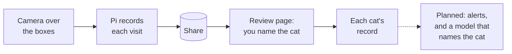

# Cat Detector

Cats hide being unwell. Often the first sign of a bowel or urinary problem is a change in how a
cat uses the litter box: how often it goes, and how long it stays.

Cat Detector is a Raspberry Pi camera mounted over the litter boxes. It records every visit, and
a review page lets you name the cat that made each one with a single key or tap. Each cat's
habits end up on record, so a change can be seen rather than guessed at.

## How it works



1. **The Pi watches** the boxes through a fixed overhead camera and keeps the last five seconds in
   memory. When something moves, it starts a clip that begins up to five seconds before the
   motion, less if the previous clip has only just ended. A clip closes after 10 s without
   motion, or at five minutes, when a new one starts if the motion goes on.
2. **Clips go to local disk first**, then, within a minute, to a share: a NAS or another disk
   (see [What you need](#what-you-need)). Recording never waits on the network, and carries on
   while the share is away.
3. **Clips are grouped into visits.** A cat that sits still stops looking like motion, so one
   visit can arrive as several clips. The review side reads the clips on the share, groups them by
   time and place, and shows each visit as a grid of tiles, stills one second apart, that you can
   label at a glance.
4. **You name the cat**, mark a peek or a litter cleaning, and the timeline shows each cat's
   visits by day and by hour.

It would rather record a sunbeam than miss a visit. A missed visit is a gap in a cat's record, and
a gap looks like the very change this project exists to catch; an extra clip costs a keypress.

**What it does not do yet:** it does not recognize the cats by itself (you name each visit), it
does not alert you when a cat's habits change, and its trigger counts changed pixels rather than
looking for something cat-sized. Each is a step in [the roadmap](docs/ROADMAP.md).

### Where to read next

| you want to | read |
|---|---|
| set it up | [What you need](#what-you-need) and [Install](#install), below |
| label visits | [Labeling visits](#labeling-visits) |
| tune it for your camera and cats | [Calibrating an installation](#calibrating-an-installation) |
| understand how it works, and why | [docs/DESIGN.md](docs/DESIGN.md), a few minutes for the whole; each part links to the decisions behind it |
| change the code | [docs/DESIGN.md](docs/DESIGN.md) and the decisions for the part you change, then [docs/STYLE.md](docs/STYLE.md) and the traps in [CLAUDE.md](CLAUDE.md) |
| see what is planned | [docs/ROADMAP.md](docs/ROADMAP.md) |
| look up a word (event, peek, tile, …) | [the glossary](docs/DESIGN.md#glossary) |

## What you need

- **A camera fixed overhead**, pointing straight down at the litter boxes, high enough that every
  box is in the picture. Because it never moves, a cat is always about the same size in it.
- **Up to three boxes, side by side across the picture.** Until boxes become a setting (roadmap
  C.3), the review page numbers them by the third of the picture they sit in, 1 to 3 from the
  left.
- **The boxes lit around the clock.** The camera cannot see in the dark, and a visit it cannot see
  is not recorded. Keep the light constant: a light that switches on with motion leaves the
  moments before it dark, and switching on changes the whole picture at once.
- **Supported hardware.** Today that is one combination: a Raspberry Pi 5 with the IR-filtered
  Camera Module 3, on Raspberry Pi OS trixie. Other Pis and cameras are planned (roadmap C.1).
- **Somewhere for the clips** other than the SD card: a mounted share, such as a NAS, another
  computer's share or a USB disk (see [The share](#the-share)). The `captures/` folder in it is
  created for you. A local-only mode is planned (roadmap C.5).
- **Room and time.** Footage is about 75 MB a minute (10 Mbit/s), and clips have averaged about
  18 MB; [the design notes](docs/design/system.md#the-local-clip-cache-is-sized-for-a-long-outage-of-the-share) have the sizing. Every event, cat or not, waits for one key
  press in the review queue.

Recommended: [pi-tools](https://github.com/Thinmindt/pi-tools), a Claude Code plugin that keeps
the Pi's logs across reboots, logs its supply voltage and temperature, powers a Pi 5 back on after
an unexpected power-off, and tells you when the Pi goes quiet. A Pi that is off records nothing,
and this project cannot notice its own absence.

## Install

1. **System packages.** `picamera2` and its `libcamera` bindings come from apt, not PyPI. They are
   built for the system's Python, so the OS sets the Python version: 3.13 on trixie.

   ```
   sudo apt update
   sudo apt install libcap-dev python3-dev python3-picamera2 ffmpeg
   ```

   `ffmpeg` builds the review page's tiles and videos; the tests use it too.

2. **The code.**

   ```
   git clone https://github.com/Thinmindt/CatDetector
   cd CatDetector
   ```

3. **The Python environment**, with [uv](https://docs.astral.sh/uv/). The venv must see the
   apt-installed packages, so `--system-site-packages` is required:

   ```
   curl -LsSf https://astral.sh/uv/install.sh | sh
   source $HOME/.local/bin/env      # puts uv on this shell's PATH; a new shell has it
   uv venv --system-site-packages
   uv sync
   ```

   > **Never delete `.venv` and run a bare `uv sync`.** uv recreates it *without* system site
   > packages, and `import picamera2` fails. Re-run both lines above to recover. Do the same
   > after an OS upgrade: the old venv's own packages vanish from `sys.path` without an error.

4. **Settings.** Create `.env` in the checkout (it is gitignored). Most installations need two
   lines:

   ```
   NETWORK_SHARE_DIR=/mnt/nas
   CAT_NAMES=Ada,Bea
   ```

   [Settings](#settings) lists the rest.

5. **Try it.**

   ```
   uv run python tests/manual/check_camera.py   # the camera works: writes test_images/test_image.jpg
   uv run python main.py                        # the detector; open http://<the Pi's address>:5000
   ```

   The page has three tabs: **Live** (the camera, and whether it is recording), **Review** and
   **Timeline**.

6. **Run it as a service**, so it starts at boot and comes back after a crash:

   ```
   sudo bash deploy/install-service.sh
   journalctl -u catdetector -f         # its logs
   sudo systemctl stop catdetector      # free the camera, which takes one process at a time
   ```

   The script builds the unit for this checkout, run as the checkout's owner and started after
   the share's mount, and stops a copy started by hand. The service also restarts itself when the
   camera stops delivering frames for 10 s. Settings for one run, such as a data run's threshold,
   go in a drop-in, systemd's file of local additions to a unit, so that re-running the script
   keeps them:

   ```
   sudo systemctl edit catdetector      # add Environment= lines under [Service]
   ```

## Labeling visits

The **Review** tab shows one visit at a time: every clip of it, each as a grid of tiles one
second apart (sparser for long clips), with the offset into the clip on each tile. Press a key,
or tap a button on a phone, and the next visit appears. The page and the commands call each one
an **event**: the clips of one visit, or of whatever else moved.

| key | button | records |
|---|---|---|
| `1`–`9` | the cat's name | that cat made the visit; the keys follow the order of `CAT_NAMES` |
| `m` | multiple | more than one cat (once `CAT_NAMES` is set) |
| `c` | cat, which one not decided | a cat whose coat the tiles do not show (under "more" once names are set) |
| `n` | not a cat | a person, a lighting change, anything else |
| `u` | unsure | the tiles cannot tell |
| `p`, then a digit | a peek | that cat looked in and used no box, so it is not counted as a visit; `p` again clears the mark |
| `l` | cleaning | a litter cleaning: type the poops found in each box, `Enter` saves |
| `z` | back | brings back the last event you labeled, to label it again |
| `→` | next | skips, while walking a filter |
| `Esc` | close | closes the "more" sheet |

New clips appear after a **rescan clip directory**, under "more", or a restart: the share is
read when the detector starts and when you ask, so a page left open shows nothing new until you
rescan (roadmap B.3 makes this automatic). Click a tile for the full frame, or **watch** to
play the clip. Between two clips, **a new visit
starts here** splits a visit; **same visit as the next event**, under "more", joins two. Both
survive `--regroup`, which rebuilds the events (below).

**What it shows.** By default the Review tab walks the **review queue**: every visit not yet
labeled, and every labeled one sent back for a second look, with the reason beside it. A
filter in the address walks another set: `/review?filter=multi` for the visits made of several
clips, `?filter=labeled` for everything labeled, `?filter=<label>` for one label. The address
names the visit, so a reload, Back or a shared link returns to it.

**Cleanings.** When you scoop the boxes, put the number of poops you found into the footage with
a hand signal, so it is recorded at the moment it was true. For each box just cleaned:

- hold a hand over that box, palm to the camera, a finger per poop;
- a closed fist means none, so a missing signal can only mean "forgot";
- hold it about three seconds, while the scooping is still being recorded (the tiles are a
  second apart);
- for more than five, use both hands, or signal twice.

The reviewer labels that event a cleaning (`l`) and types the counts in.

The **Timeline** tab lists the events that match, newest first, with their time, label, box, length
and clip count; it shows the newest 500 and counts them all. Label chips choose which labels show,
so one cat's rows are that cat's visit log. Drag across the day strip or the hour strip to take a
slice of time ("outside the range" turns 06:00–22:00 into the night), and "labeled before" picks
out old labels. Any row, or everything the filter matches, can be sent back to the review queue
with a reason. The filter is kept in the address.

From the command line, beside the running service, `--stage` sends labeled events back to the
review queue with a reason, keeping their labels; here, every `not_cat` labeled before 20
September. `--source` says who asked: `human` by default, or `agent` or `model`.

```
uv run python main.py --stage --label not_cat --labeled-before 2026-09-20 --reason "recheck"
```

`--regroup` rebuilds every event from the current [grouping settings](#settings). It renumbers
the events, so stop the service first; labels follow their clips.

## Calibrating an installation

The default thresholds come from one installation. Another camera height, lens, framing or set
of cats needs its own numbers, and they come from a **data run**: a week or two of recording
everything, labeled by hand. Until then the default of 300 is a starting point, not a promise:
a cat that reads weaker than the one it came from may not reach it.

1. **Start the data run.** Settle the framing, the lighting and the camera mode first: changing
   one afterwards means starting the run again. Then, in the service's drop-in (`sudo systemctl edit
   catdetector`), set a low threshold so nothing is missed, and turn on the per-frame metrics:

   ```
   [Service]
   Environment=MOTION_THRESHOLD=150
   Environment=METRICS_CSV=/home/you/metrics.csv
   ```

   Keep the CSV on local disk; it grows by about 150 MB a day. Note when the run starts.

2. **Label every day.** Name the cat on each visit, mark peeks, and join a visit that was split in
   two. Labeling is what limits a data run: fall behind, and the backlog outlives the run.

3. **Check progress** now and then, beside the running service:

   ```
   uv run python main.py --calibrate --since 2026-09-16
   ```

   It reads the run's settings from the service's drop-in and says where they came from
   (`--metrics PATH` names another CSV). A couple of weeks of CSV takes several minutes. It
   reports what the run still needs:

   - 50 visits (100 is better), 10 of them at night (20:00–06:00), and 15 per cat;
   - every box used: a cat staying 10 s in that box's third of the picture (with fewer than
     three boxes, name the thirds that hold one: `--boxes 1,3`);
   - the weakest visit settled: none of the last 20 weaker than the weakest before them (a
     visit's strength is the largest blob it made; see the [glossary](docs/DESIGN.md#glossary)).

   Varied weather, including an overcast day, is yours to judge; it matters less when the boxes'
   own light swamps the daylight. It also sends events that need a second look to the review
   queue, each with its question, and asks each question only once:

   - the same cat seconds apart: one visit split in two?
   - the weakest visits: a peek?
   - `not_cat` events that held something visit-sized: a cat after all?
   - a visit the metrics show no blob for: is its label right?

4. **Apply the result.** Once every condition holds, it replays a range of thresholds over the CSV.
   For each it shows the visits it would miss, how many clips an hour it would start with no cat in
   them, and how much of each visit it would record. It can judge only the visits the run recorded,
   which is why the run's threshold is low. It proposes the highest threshold that misses no visit
   and still records 98 % of the median visit. It may record under 80 % of a few more visits than
   the run did, at most 5 % of them. The proposal is marked provisional while any of its questions
   waits in the queue. Put it in the drop-in, remove `METRICS_CSV`, and restart the service.

## Settings

Settings come from `.env` in the checkout, or from the service's drop-in; the drop-in wins.
`config.py` describes each one.

| setting | default | what it sets |
|---|---|---|
| `NETWORK_SHARE_DIR` | `/mnt/nas` | the share; clips land in its `captures/` |
| `CAT_NAMES` | none | the cats, comma-separated, in the order of their digit keys |
| `LOCAL_CLIP_DIR` | `.clip_cache` | where clips are written before they ship |
| `DB_PATH` | `captures.db` | the review database: local disk, never the share |
| `REVIEW_CACHE_DIR` | `.review_cache` | the review page's tiles and videos |
| `MOTION_THRESHOLD` | 300 | changed pixels, of the 640x480 analysis frame, that start a clip; from one installation, and `--calibrate` proposes yours |
| `MOTION_TIMEOUT` | 10 | seconds without motion before a clip closes |
| `MOG2_HISTORY` | 500 | frames the background model (MOG2) learns over; something still fades into it in about that many |
| `DARK_BRIGHTNESS` | 10 | mean gray level, 0–255, below which motion is ignored |
| `EVENT_GAP_SECONDS` | 180 | how soon a clip must follow the last to join its visit |
| `EVENT_BOX_DISTANCE_PX` | 120 | how close two clips' positions must be to count as one box |
| `METRICS_CSV` | off | a local file for a row of detection metrics per frame, for a data run |
| `CAPTURE_HEARTBEAT_URL` | off | a URL pinged once a minute while the camera delivers frames |

### The share

`NETWORK_SHARE_DIR` must be a real mountpoint, so that a missing mount cannot fill the SD card,
and a rename within it must be atomic, so that no one sees a half-copied clip. A NAS, another
computer's SMB or NFS share, a USB disk and cloud storage mounted with rclone all qualify; on a
cloud mount the review page's tiles are slow to build. A plain local directory is refused for
now (roadmap C.5).

Mount a share from `/etc/fstab` with the `soft` option written out. On a `hard` mount an
unreachable server blocks writes forever instead of failing. `soft` is the CIFS default, so it is
easy to lose without noticing, and NFS mounts `hard` unless told otherwise.

### The capture heartbeat

Set `CAPTURE_HEARTBEAT_URL` to be told when the camera stops. The detector then sends an HTTP GET
to it once a minute, but only while the camera is delivering frames. A dead man's switch watching
that URL alerts you when the pings stop: a stalled camera, a detector restarting in a loop, or one
that is not running at all.

The check that receives the pings is yours to set up: a free one at
[Healthchecks.io](https://healthchecks.io), a self-hosted Healthchecks, an Uptime Kuma push
monitor, or any service that alerts when a URL stops being fetched. Give it a period of one minute
and a grace time of at least three, so a routine restart does not alert. If pi-tools pings a check
for the Pi, make a second one for the camera: the Pi can be up while the camera is not.

The URL is a secret, since anyone who has it can keep your check quiet. Keep it in `.env` and out
of every tracked file; `scripts/check_private.sh`, one of the gates `scripts/check.sh` runs, fails
on a commit that contains it. A URL that is not `http://` or `https://`, has no host, or contains a
space turns the heartbeat off with a warning. So does a recorder that failed to start, since frames
would then arrive with nothing recorded.

## Security

**The web page has no login.** The live camera, every recorded clip and the labels are open to
anyone who can reach port 5000, over plain HTTP, from Flask's development server. Run it only on a
network you trust, and **do not forward port 5000 through your router** or let UPnP open it. To
reach it from outside, put authentication and a real WSGI server (waitress, gunicorn) in front of
it first.

## Developing

```
npm install                  # once per checkout, for the JavaScript lint (needs node)
bash scripts/check.sh        # every gate, stopping at the first failure
uv run pytest                # the tests alone: no camera or picamera2 needed, ffmpeg is
uv run ruff check --fix .    # lint, fixing what it can
uv run ruff format .         # format
npm run vendor               # after changing d3's version in package.json
```

`check.sh` runs the privacy check, shellcheck, codespell, ruff, the format check, mypy, eslint, a
check that the committed d3 matches the version `package.json` pins, and pytest, whose tests
include the documents' own: links, settings, options, keys, spelling and readability. GitHub Actions
runs the same script on every push, and every commit must pass it. A second job runs this
README's install steps on a clean Debian, then the tests. Read
[docs/DESIGN.md](docs/DESIGN.md) and the decisions behind the part you change before changing behavior, [docs/STYLE.md](docs/STYLE.md) before
writing code, and the traps in [CLAUDE.md](CLAUDE.md), which is written for coding agents and
useful to anyone.

## License

MIT — see [LICENSE](LICENSE).
