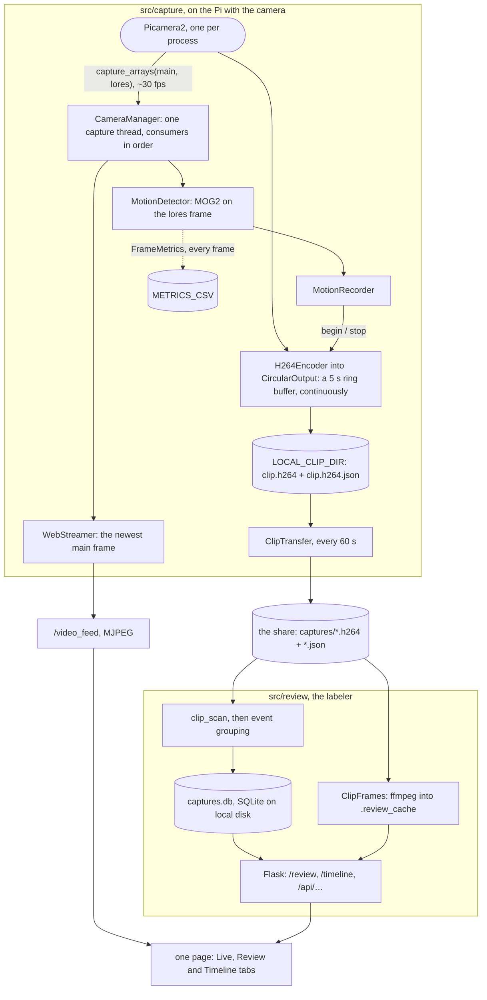
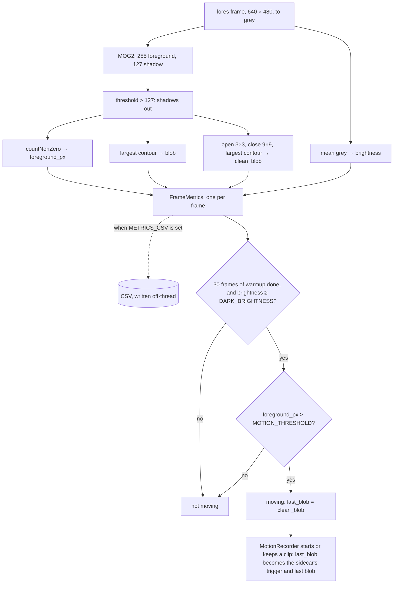
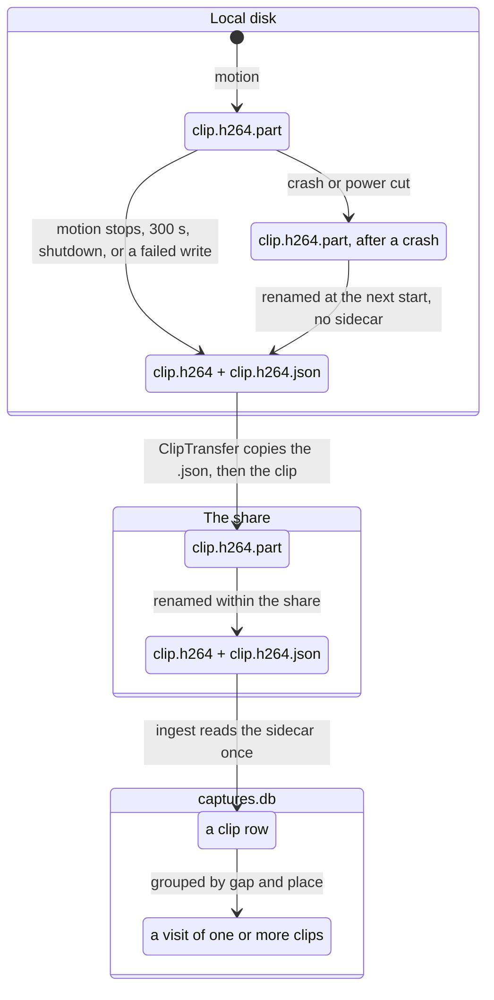
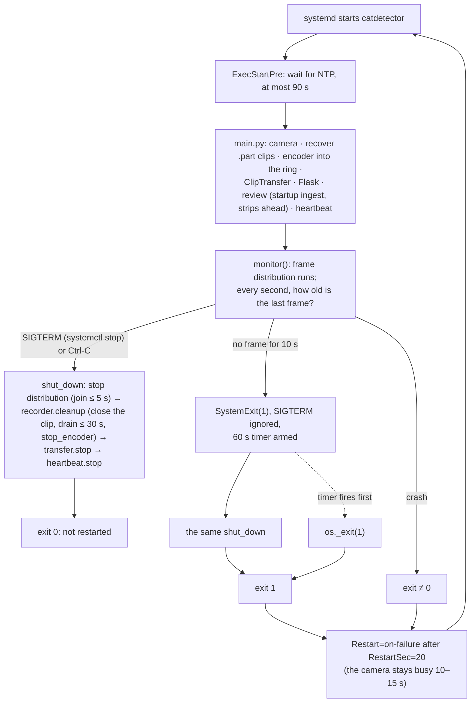
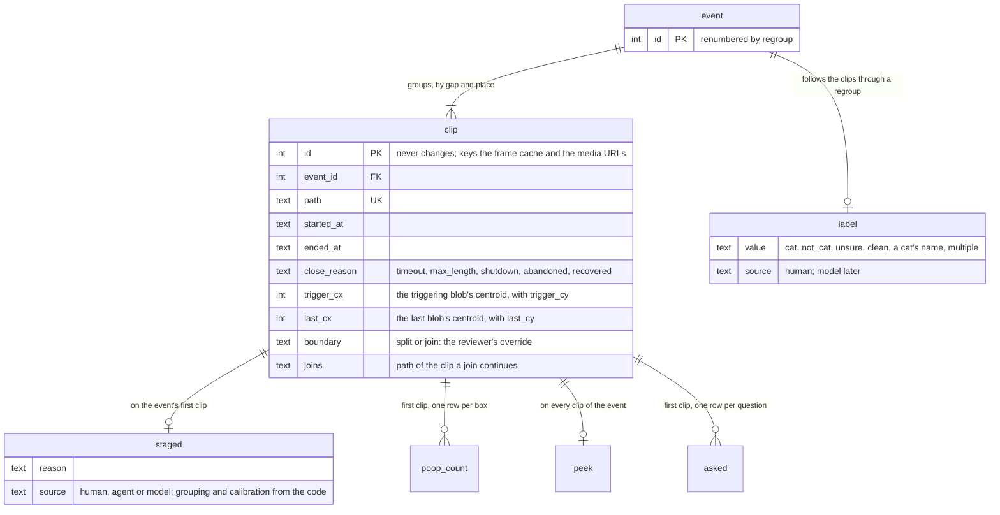
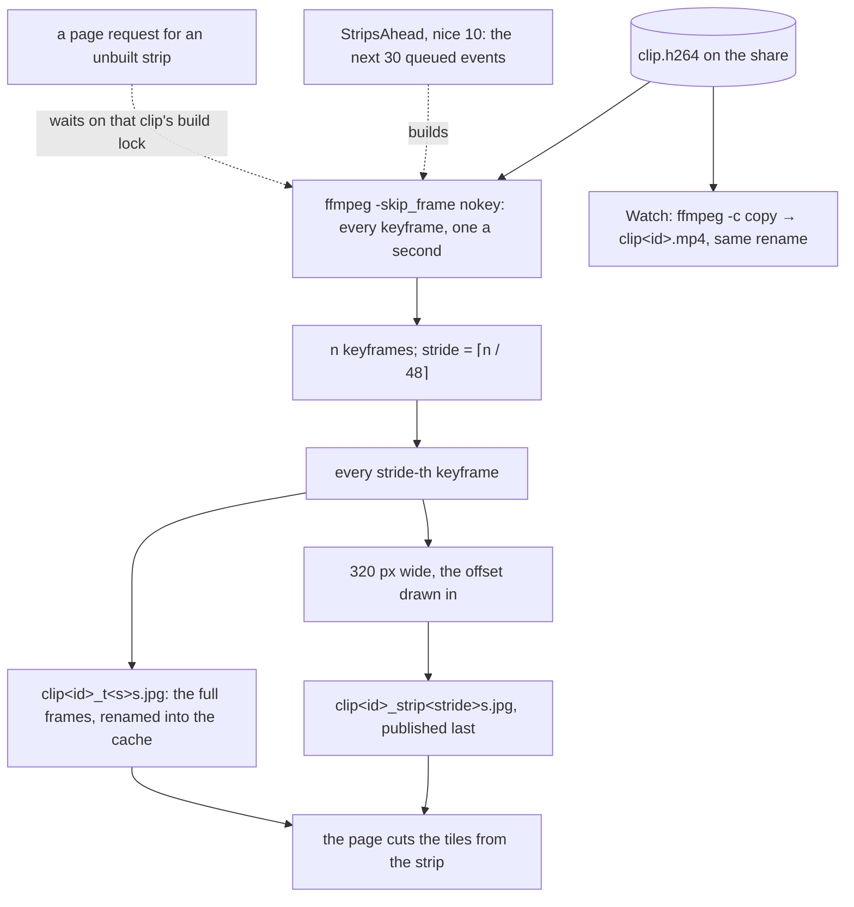

# Design decisions

Why the code is shaped the way it is. Kept here so the source can stay terse.

Entries cite `ROADMAP.md` by section (A.2, A.4, B.5b, …). Words with a meaning of their own
here (visit, event, sidecar, tile, …) are defined in the [Glossary](#glossary) at the end.

Each section is one thing the system does. It opens with how that works today, with a picture
where there is a flow, a state machine or more than one thread, and the entries under it are the
decisions that gave it that shape: what was decided, why, and when it was measured. The pictures
are Mermaid, which GitHub renders in place; a box or an arrow in one is a claim about the code and
is held to the same standard as a sentence.

## Goal

**The point of the project is catching bowel or urinary trouble in a cat.** Knowing which cat
made a visit is the way there, not the goal itself. Three things follow from it:

- **Recall comes first.** A missed visit leaves a gap in a cat's record. A gap can look like the very
  change the project exists to flag, so losing a visit can lead to wrongly flagging a healthy cat. An
  extra clip only costs review time.
- **A visit may span several clips.** It is fine to stop recording while nothing is truly moving, for
  example while a cat sits still in the box, as long as the clips on either side of the pause are
  linked to the same litter-box event. One clip does not have to stay open through the stillness.
  Clips are linked into events at ingest; see From clips to events below, and ROADMAP A.4.
- **Poop versus pee is a possible later step.** Telling them apart looks hard and error-prone, so
  nothing should depend on it.

## The system at a glance

One process on the Pi does everything, in two halves that share no objects. The capture half owns
the camera, decides when something is moving and writes clips to local disk; the review half reads
those clips back from the share, groups them into visits and serves the page a person labels them
on. The whole contract between the halves is a clip and its sidecar on the share, so either half
can change without the other noticing, and the review half imports without the camera stack, which
is how it runs on a machine with no camera and what the lint gate (`TID251`) keeps true.

Two things in the picture carry most of the weight. The camera's frames take two independent
paths: the fan-out, on one capture thread, feeds detection and the live view, while the recorded
bytes go through picamera2's own encoder into a ring buffer that the recorder diverts to a file
when motion starts; changing frame distribution does not change what is recorded, and vice versa.
And nothing on the capture side writes to the share: clips land on local disk
and `ClipTransfer` ships them on its own thread, so the camera never waits on the network and
recording survives an outage of the share. Each half keeps its own state on local disk, the clip
cache on one side and the database and frame cache on the other; the share holds only the clips.

The code follows the same split. `src/web_app.py` assembles the one Flask app from both halves,
`src/logging_setup.py` configures logging, and `main.py` is the only entry point.

| package | holds | may import |
|---|---|---|
| `src/capture/` | everything that touches the camera: `camera_manager`, `motion_detector`, `motion_recorder`, `motion_metrics`, `clip_transfer`, `capture_heartbeat`, `web_streamer` | `picamera2`, `src.clips` |
| `src/review/` | everything that reads the share and serves the labeler: `clip_scan`, `capture_db`, `event_grouping`, `clip_frames`, `strips_ahead`, `timeline`, `api`, `calibration` | `src.clips`, never `picamera2` |
| `src/clips/` | what both sides agree a clip is: `format` (suffixes, `partial_name()`, `CAMERA_FPS`, `H264_BITRATE`, `ANALYSIS_SIZE`), `sidecar`, `blob`, `frame` | the standard library and numpy only |

**The local clip cache is sized for a long outage of the share.** Clips accumulate on local
disk while the share is away and ship when it returns, where an in-memory buffer would fill
and drop footage. Clip data arrives at `H264_BITRATE / 8` bytes a second, 1.25 MB/s at the
constant's value of 10 Mbit/s, so the 300 s `max_clip_seconds` ceiling is 375 MB. Clips have
averaged ~18 MB, so every 100 GB of free local disk holds roughly 5,500 of them, and
`_has_room`'s 1 GB floor is a guard against a months-long outage, not a routine constraint.
SD wear is not a concern at this volume: 20 such clips a day is ~134 GB a year, a fraction of
a card's write endurance.

**`src/` is three packages: `capture`, `review`, and `clips` for what both agree a clip is**
(2026-09-20): its names, its sidecar, the `Blob` and `Frame` types. The rule that the review
side imports without the camera stack is ruff's `banned-api` (`TID251`) on `picamera2` and
`libcamera`, with a per-file allowance for `src/capture`, so a stray import fails the lint gate
rather than a machine without a camera; a rule written only as prose is broken without anyone
noticing. `Blob` lives in `src/clips` rather than `motion_metrics` because the sidecar needs it,
and importing it from `motion_metrics` drags the CSV writer and the morphology kernels into the
review side.

**One app, one port** (2026-09-12). `web_app.create_app` takes the streamer and the
review parts as optionals and serves whatever it was given, and a review database that fails to
open leaves the Live tab up rather than taking the detector down, in the same spirit as a broken
recorder leaving the stream up. `main.py` is the only entry point (2026-09-20): with the detector
running as a service around the clock the Review tab is always up, so a second, camera-less
script serving the labeler on the same port would be one more thing to explain and could never
run beside it. `main.py --regroup` covers regrouping without the web app. The cost is that a
machine with no camera cannot run the labeler; the review package imports without the camera
stack (`TID251`), so a camera-less entry point needs no change to it. The page is a Jinja template
rather than a string in a Python module: ruff's line limit applies inside strings, and JavaScript
wrapped to satisfy it is unreadable.

**Detection is its own class** (2026-09-20). `MotionDetector` holds MOG2, the warmup, the dark
gate and the last blob, and answers a `Detection` per frame; `MotionRecorder` takes one and turns
its answer into a clip lifecycle. With the two in one class, every test of a threshold or a warmup
count has to fake the camera, the encoder and the ring buffer to reach the detector, and A.3 grows
exactly the detection half.

**Nothing under `src/` reads `Config`** (2026-09-20). `main.py` reads it and passes settings down,
for both sides; `CaptureDB` requires its grouping thresholds and the review routes take the
captures directory in a `Review` dataclass. A module that falls back to `Config` has a hidden
input that a test or a second caller cannot see.

**Domain types inside, ISO text at the edges** (2026-09-20). `Clip`, `Event` and `FoundClip` carry
`datetime`s, a `CloseReason` and a `Boundary` enum; SQLite and the JSON API see ISO 8601 text to
the millisecond, formatted by the one `iso()` in the sidecar module. Flattening the sidecar's
datetimes to strings in the scan means the database parses them back for the grouping rule.
`CloseReason` includes `RECOVERED`, so a clip's reason is one type whether the recorder or ingest
assigned it.

## Threads and locks

The process runs about ten threads. The table is the map: what each one does, which locks it
takes and what it must never do. The entries under it are the measurements and failures that put
each rule there.

| Thread | Runs | Takes | Must never |
|---|---|---|---|
| main | `main.py`'s setup, then `monitor()`: once a second, how old is the last frame; the shutdown | — | — |
| capture (`CameraManager._distribute_frames`) | `capture_arrays` for both streams, then every consumer in turn: `MotionRecorder._process_frames` (detect, open or close a clip) and `WebStreamer._consume_frames` (copy the frame) | `_frame_lock` around the capture alone; `WebStreamer.frame_lock` for one assignment | wait on a disk, the network or another thread. A consumer that blocks it stops detection, and after 10 s the process restarts |
| picamera2's output thread: the camera event loop on a Pi 5, `V4L2Encoder.thread_poll` on a Pi 4 | the H.264 encode of every `main` frame and every write of clip bytes, through `_ResilientCircularOutput` | `Picamera2.lock`, the encoder's lock, `CircularOutput._lock` | raise, which ends the loop and freezes capture; write anywhere but local disk |
| drain, one per clip end (`MotionRecorder._finish_clip`) | `CircularOutput.stop()`: the ring written out, then the sidecar, then the rename | `CircularOutput._lock` for the whole drain, which the output thread waits on | write to the share |
| metrics writer (`MetricsLog`) | rows off a bounded queue into the CSV | — | block the capture thread: a full queue drops the row |
| `ClipTransfer` | every 60 s, copy finished clips to the share, sidecar first | — | nothing; it is the one capture-side thread that may block on the share |
| `CaptureHeartbeat` | one GET a minute, 10 s timeout, while the last frame is under 10 s old | — | log the URL |
| Flask request threads (`threaded=True`) | the pages, the review API, and one `generate_frames` generator per live viewer | `CaptureDB._lock`, an `RLock` around its one SQLite connection, through `@serialized`; a per-clip build lock in `ClipFrames` | hold `CaptureDB._lock` while reading the share; hold `WebStreamer.frame_lock` across a `yield` |
| `startup-ingest` | one scan of the share when the process starts | `CaptureDB._lock` only to insert what the scan found | — |
| `strips-ahead`, reniced to 10 | the strips of the next 30 queued events, one clip at a time | `CaptureDB._lock` to read the queue; the clip's build lock | hold the database lock while ffmpeg runs |
| stall deadline (`threading.Timer`) | `os._exit(1)` 60 s after a stall, if the cleanup has not finished | — | — |

Across processes, every open `CaptureDB` holds a shared `flock` on `<database>.lock`, and
`regroup` takes it exclusive.

The rule the table enforces: the two threads the camera depends on, the capture thread and
picamera2's output thread, wait on nothing that can stall: not a network share, not another
thread, not a lock held across I/O. Everything that can block, the share, ffmpeg, HTTP, the CSV,
has a thread of its own, and the review side does its share I/O with no database lock held.

**Consumers run outside `_frame_lock`.** The lock covers capture only. Consumers run
synchronously on the capture thread, so a slow one throttles everything; a lock held across them
as well would let one blocked consumer stop capture itself. Exceptions are caught per consumer so
one bad consumer cannot stop the loop.

**Joins are bounded.** A wedged consumer must not make shutdown hang. Five seconds, then log and
move on.

**Nothing may raise out of the thread that writes clip bytes** (2026-09-26). Which thread that is
depends on the encoder picamera2 picks, and `H264Encoder` is a different class per platform
(`picamera2/encoders/__init__.py`):

- **Pi 5 (`Platform.PISP`), the tested platform.** `H264Encoder` is
  `LibavH264Encoder`, a software x264 encode. Clip bytes are written on picamera2's **camera
  event-loop thread**: `NullPreview.thread_func` → `handle_request` →
  `Picamera2.process_requests`, which calls `encoder.encode` for each request while holding
  `Picamera2.lock` → `Encoder.encode` (under the encoder's `_lock`) → `LibavH264Encoder._encode`
  → `outputframe` → `CircularOutput.outputframe` → `_write`. `handle_request` logs an exception
  and re-raises it, which ends the event loop: no request completes again, so every
  `capture_arrays` waits forever — a silent, total freeze. The x264 encode and each write run
  synchronously on that thread, so a slow write stalls capture directly, frame by frame. The
  final flush of frames still inside libav (`LibavH264Encoder._stop`) runs on whichever thread
  calls `stop_encoder`, which is the one in `MotionRecorder.cleanup()`.
- **Pi 4 (`Platform.VC4`).** `H264Encoder` is the V4L2 hardware encoder, and output runs on
  `V4L2Encoder.thread_poll`. That thread is the only one that calls `queue_item.release()` to
  return camera buffers and refill `buf_available`. Kill it and `_encode` blocks forever on the
  camera event loop, with the same freeze as a result.

`FileOutput._write` catches only `ConnectionResetError`, `ConnectionRefusedError`,
`BrokenPipeError` and `ValueError`, so `_ResilientCircularOutput` swallows `OSError` too and marks
the clip abandoned.

It also guards `outputframe`. `CircularOutput.outputframe` appends under `_lock`, releases, then
re-acquires to `popleft`; `stop()` can drain the whole ring in that window, making `popleft`
raise `IndexError` on the output thread. Rare per clip end, but every clip end rolls the dice.

**Draining happens off-thread, and the destination must be local disk** (2026-09-26).
`CircularOutput.stop()` writes the entire ring buffer with a flush per frame, holding the
output's `_lock` throughout. `_finish_clip` runs it on its own thread, so the capture thread and
its consumers do not do the write; handoff measured ~0.3 ms (2026-08-25). That does not keep the
drain off the camera: `outputframe` takes the same `_lock`, so the thread that writes output
(the event loop on a Pi 5) waits for the drain whichever thread runs it. On local disk the wait
does not show: across 14 clip stops, the largest gap between consecutive frames in the 6 frames
after each stop was 0.037 s against a 0.033 s frame period (metrics CSV, 2026-09-26). Draining
several megabytes to a network share would hold the camera for the length of that write, which
is one more reason clips are staged locally.

**Metrics are written off the capture thread.** `MetricsLog.record()` puts a row on a bounded
queue; a daemon thread writes and periodically flushes. When the queue fills, rows are dropped
and counted rather than blocking — the capture thread must never wait on a disk. The CSV lives
on local disk, not the share: one row per frame at 30 fps is exactly the small-write pattern
that CIFS handles worst.

**The share is read outside the database lock** (2026-09-18). `serialized` exists to stop
concurrent reads corrupting SQLite's cursors. Under it, `ingest` — which globs the share and reads
every new sidecar over CIFS, up to a couple of minutes per failing operation on a soft mount —
would hold every reader of the review UI behind it. So `ingest` collects paths, sizes and sidecar
facts with no lock held and takes it only to insert, place and commit;
`INSERT OR IGNORE` covers a clip that another ingest registered in between. The share-reading
half is its own module, `clip_scan.py`, with no lock in it (2026-09-19): the rule is then a
property of the import graph rather than of one method's care.

**The startup ingest runs on its own thread** (2026-09-22). It scans the share, and a soft CIFS
mount that is unreachable at boot fails each operation only after one to two minutes. Run before
`monitor()` starts frame distribution, the scan would delay the first recording by that timeout
while the share is down, with the camera and encoder already up. The review page can come up a few
seconds before the scan lands; `rescan` covers a reviewer who beats it.

## Capturing frames

`CameraManager` configures two streams from the one sensor: `main` at 1280x720 for the recording
and the live view, `lores` at 640x480 (`ANALYSIS_SIZE`) for detection, from the full array binned
2x2. One blocking `capture_arrays` call a frame returns both, which paces the loop at the sensor's
~30 fps, and the consumers, registered with `add_consumer`, run one after another on that
thread.

**One `Picamera2` per process.** picamera2 allows only one instance, so `CameraManager` owns it
and everything else borrows via `get_camera()`.

**`capture_arrays(["main", "lores"])`, never two `capture_array()` calls.** Each `capture_array`
waits for and consumes its own libcamera request. Two calls therefore cost two frame periods and
return frames from different exposures ~33 ms apart. Measured on the imx708 (2026-08-25): 15.01
fps for two calls, 30.00 fps for one `capture_arrays`. It returns `(arrays, metadata)`, not a bare
list.

**No sleep in the capture loop.** `capture_arrays` blocks until the next frame, which paces the
loop at the sensor rate. An added sleep is pure loss: a `sleep(0.033)` on top of two blocking
captures runs the loop at ~10 fps (2026-08-25).

**The sensor mode is pinned to the full array.** picamera2 picks a sensor mode by output size.
For these streams it chose 1536x864, a 2x2 binning of a 3072x1728 crop, which keeps only the
central two thirds of the imx708's width. Asking for 2304x1296, the whole array binned 2x2, gives
the widest view; an installation may widen or crop it to keep its boxes in frame. Tested at
2304x1296 (2026-09-10): the detector held 30 fps.

Pixel measurements depend on the mode. In the full-array mode an object spans about two thirds as
many pixels in each direction as in the cropped one, so roughly 0.44 of the area. Metrics from one
mode cannot be compared with another's, so settle the mode and the framing before recording the
metrics a threshold is tuned from.

## Detecting motion

Every `lores` frame is measured the same way whether or not metrics are being logged, and the
trigger decides from that measurement. MOG2 holds the background model; the pixels it marks as
foreground rather than shadow are counted, and their largest region is kept both raw and after a
morphological clean-up. The trigger is the count against `MOTION_THRESHOLD`, gated by a warmup
and by the frame's brightness; the cleaned blob is what the sidecar records.

The settings an installation tunes, `MOTION_THRESHOLD`, `MOTION_TIMEOUT`, `MOG2_HISTORY` and
`DARK_BRIGHTNESS`, come from the environment and reach the detector as constructor arguments.
Calibration, at the end of this document, is how a data run turns into their values.

**MOG2 warmup.** MOG2 has no background model on its first frame and reports the whole frame as
foreground, which triggered a clip on every startup. Measured on the imx708 (2026-08-24, in the
cropped sensor mode): frame 0 is 100% foreground, frame 1 ~3.8% (still far over any threshold),
frame 2 onward under 25 pixels. `warmup_frames = 30` is ~1 s of margin.

**Shadows are excluded by thresholding, not by disabling shadow detection.** MOG2 marks shadow
pixels 127 and real foreground 255. Turning `detectShadows=False` off is a no-op for this
purpose: it relabels those pixels 255 instead of removing them, and `countNonZero` returns the
same number either way. Verified against real MOG2 (2026-08-26) — with a synthetic shadow, both
settings counted 3400 pixels, of which 1600 were shadow. Shadow detection stays on and the mask is
thresholded at 127 so only true foreground counts.

**Every frame is measured once, whether or not metrics are on** (2026-09-19). `detect_motion`
decides from the same `FrameMetrics` the log receives, so the trigger and the CSV can never
disagree, and A.3's size band reads its blob from the same place. The whole measurement, on the
Pi 5 with a synthetic 640x480 mask (2026-09-19): 2.4 ms for a cat-sized blob or an empty mask,
9 ms for a mask that is 1 % speckle (raw-contour extraction on the noise), against a 33 ms frame
budget. With the camera running and metrics on, the service held 30.0 fps (from the metrics
timestamps, 2026-09-18), while that path measured motion frames a second time, so measuring every
frame costs no more than a metrics-on run.

**Blobs are logged both raw and cleaned, along with frame brightness.** Cleanup is a
morphological open with a 3x3 ellipse, which drops speckle, then a close with a 9x9 ellipse,
which joins the pieces MOG2 splits one cat into. A.3's trigger is planned on the largest blob
after cleanup, so logging it during the A.2 run gives the size band the same numbers the trigger
sees. The raw blob is logged too, so other kernel sizes can be judged from the same data.
Brightness is the mean grey level of the analysis frame. It makes lighting changes easy to pick
out, and they are the main source of non-cat clips. Measured alone on a Pi 5's CPU with a
synthetic mask (2026-09-11), cleanup plus contours cost about 1.7 ms a frame and brightness
0.03 ms; the 2.4 ms above is the whole per-frame measurement that contains them.

**Known weakness: a global pixel count.** Detection compares the number of foreground pixels
anywhere in the frame against one threshold, with no spatial coherence, so scattered noise and
one cat-sized blob look the same. Shadows do not count; see Shadows above. See ROADMAP.md
part A.

**A data run uses a low threshold** (ROADMAP A.2), catching too much rather than missing a
visit, and trying another value needs no code change. `MOTION_TIMEOUT` defaults to 10 s and
`MOG2_HISTORY` to 500 frames.

**The default threshold is 300 px** (2026-09-11, from one visit). A walking
cat measures about 400–1,400 foreground px in the full-sensor view, and about 3,300 at peak in the
cropped mode, so a threshold of 5000 records no visits at all and 2000 loses the end of a visit.
Idle noise in the same view stays under 100 px in 99.9% of frames and peaks at 228, so 300 sits
between the two. It is a safety net for a run that forgets to set the variable, not a tuned value;
the tuned value is A.2's to derive (ROADMAP C.4 covers other installations). The default lives in
`config.py` alone: `MotionDetector` requires `motion_threshold` as an argument.

History sets how long a still cat takes to fade into the background: roughly history ÷ 30
seconds. The timeout then closes the clip. The goal allows a visit to span several clips, so
neither setting has to be stretched to cover a cat sitting still.

**A dark scene cannot trigger** (2026-09-14). The camera is the IR-filtered imx708, so an unlit
room is black to it. Unlit, after a light went off, the mean grey
level sat at 1.1–2.7 and sensor speckle alone gave 200–295 foreground px on every frame. At a
threshold of 150 that recorded back-to-back 300 s clips of black, about 2 GB/h. Raising the threshold would cost daytime recall and gain nothing,
because no cat is visible in that footage anyway. So `detect_motion` ignores motion while the
analysis frame's mean grey level is below `DARK_BRIGHTNESS`. Its default of 10 sits between the
brightest frame that night (2.7) and the dimmest lit frame that evening (46.1), leaving room for a
dim night-light. MOG2 keeps learning in the dark, so its background is current when the light
returns; the light coming on is itself a whole-frame change and records one clip. Each change
between dark and lit is logged. This removes the waste, not the gap: visits in the dark go
unrecorded, which is why light around the clock is a requirement (ROADMAP C.2). A lit night
averaged ~125/255 (2026-09-20), so the gate matters only if the light fails.

**A file with a different column layout is never appended to.** Mixing layouts would corrupt the
CSV, so `MetricsLog` leaves the old file alone, writes to a timestamped sibling and logs a warning.

## Recording and shipping a clip

The encoder runs continuously into a five-second ring buffer, and nothing reaches disk until
motion starts. From there a clip's life is a sequence of renames, each atomic because it stays
within one filesystem, and only a final name means complete: that holds on local disk, where the
recorder writes, and again on the share, where `ClipTransfer` copies to. The facts the raw stream
cannot carry, when the clip started and ended, where the cat was and why the clip closed, travel in
a sidecar that is written before the clip takes its final name and copied before it.
`MotionRecorder` diverts the ring with `_ResilientCircularOutput.begin(<.part path>)`: from the
next frame on, the file starts at the ring's oldest keyframe and the ring drains a frame for
every frame that arrives, until `stop()` writes out what remains. `ClipTransfer`'s scan is
stateless: each pass ships whatever finished clips it finds, so one stranded by a crash ships on
the next.

**Two names, and only one means "done".** The recorder writes `<clip>.h264.part` and renames to
`<clip>.h264` once the file is closed; `ClipTransfer` copies to `<clip>.h264.part` on the share
and renames within the share. Both renames are same-filesystem, so they are atomic. A reader
therefore never sees a final-named clip that is still growing. This is what stops the review
server ingesting a half-written clip and caching a thumbnail strip from footage that does not
show the visit. A cross-filesystem `shutil.move` would *not* do this — it degrades to copy then
delete, exposing the final name immediately.

**Every finished clip ships with a sidecar.** Raw H.264 carries no duration and `ClipTransfer`'s
copy drops the mtime, so once a clip reaches the share nothing says when it ended or where in the
frame the cat was. `<clip>.h264.json` records the start and end wall times, the cleaned blob that
triggered the clip, the blob on its last motion frame, and why it closed (`timeout`, `max_length`,
`shutdown`). Those are the inputs to event grouping (ROADMAP A.4). Grouping is decided later from
the sidecars rather than at capture time, because the gap threshold is set from data, and a rule
over recorded facts can be re-run when it changes. The recorder writes the sidecar *before*
promoting the clip and `ClipTransfer` copies it *before* the clip, so neither the local scan nor
the review server can see a finished clip without its facts. A clip recovered after a crash has no
sidecar; ingest treats that as `recovered` and estimates the end from size. The blobs come from
the per-frame measurement described under Detecting motion, so recording them costs nothing extra.

**A clip abandoned mid-write says so** (2026-09-16). When `_ResilientCircularOutput` gives up on a
clip, `_finish_clip` still writes the sidecar and still promotes the clip — a truncated clip beats no
clip — but the `close_reason` it records becomes `abandoned` rather than the `timeout`,
`max_length` or `shutdown` the caller asked for. The sidecar is the only record of how a clip ended,
so a truncated one that claimed `timeout` read as an ordinary visit in review, and grouping trusted
its `ended_at`, which is the moment the write failed rather than the moment the cat left.

**Clips cut off mid-write are recovered at startup.** A crash, a `kill -9` or a power cut while a
clip is open leaves `<clip>.h264.part`. Only final names ship, so that visit would be lost. The raw
stream decodes up to the cut: a copy of a real clip truncated at half its size gave 252 of its 486
frames, and ffmpeg's only complaints were two errors about the last, partial frame (2026-09-11).

So when the recorder is constructed, before it opens a clip of its own, it renames every non-empty
`.part` in its directory to its final name, and `ClipTransfer` ships them on its next pass. Empty
ones are discarded like any empty clip. A final name that already exists is never overwritten;
the `.part` is left for a person to look at.

**`buffer_seconds = 5`.** `stop()` empties the ring buffer, so pre-motion footage is bounded by
the gap since the last clip ended regardless of buffer size. A 30 s buffer buys nothing and
makes every drain ~37 MB (2026-08-25). `.start()` flushes from the *oldest* keyframe in the
buffer, not the most recent.

**Clips are `.h264`.** `CircularOutput` writes a raw elementary stream. Naming it `.mp4` claimed
a container that was never there. They decode fine but carry no duration and cannot seek; remux
with `ffmpeg -i clip.h264 -c copy clip.mp4` if that matters.

**Bounded clip length and a free-space check.** Nothing else closes a clip except the motion
timeout, and anything that keeps triggering — a sunbeam, a moving shadow — would record without
bound at `H264_BITRATE` (4.5 GB/hour; see the clip cache's sizing under The system at a glance). ENOSPC is not merely a failed
recording; it is the `OSError` above. `_has_room` guards the *local* clip directory, throttled to
one check every 5 s: it runs on the capture thread for every motion frame, so an unthrottled
`statvfs` plus its warning means 30 syscalls and 30 log lines a second for as long as the disk
stays full.

**A clip that cannot open is logged at most once a minute** (2026-09-27). Motion retries
`_start_saving` on every frame, so an open that keeps failing (a clip directory that is not
writable) logged a full traceback 30 times a second for as long as the motion lasted. Now a failure
logs its traceback only if none was logged in the last minute, and the first open that succeeds
says so. Once per failure streak is not enough: a streak ends only when an open succeeds, so a
failure that lasted days would have left every missed visit after the first unlogged. A missing
directory is caught earlier, by `_has_room`, which is already throttled.

**Monotonic clock for durations.** A Pi without an RTC backup cell boots with a stale clock that
timesyncd then steps. With `time.time()` a backward step makes the
elapsed difference negative and holds a clip open for the size of the jump; a forward step
truncates one early.

**UTC is not used for clip names.** Local time is friendlier for browsing, so collisions across
the DST fall-back are handled by never returning a path that already exists.

**Mount the share `soft`, and say so.** `soft` is the CIFS default, so an fstab line that does
not name it gets it anyway. On a soft mount an unreachable server makes writes fail with an error
after ~1–2 minutes (governed by `echo_interval=60`) instead of blocking forever, which is what
lets `ClipTransfer`'s `OSError` handling work at all. With clips written locally first, a `hard`
mount stalls only `ClipTransfer`'s thread rather than the camera, but pin `soft` explicitly
anyway: switching it looks like a robustness improvement and is the opposite.

**`ClipTransfer` writes only to a mounted share.** `_share_is_ready` checks
`os.path.ismount` before every pass. Writing under an absent mountpoint would put `captures/` on
the SD card, filling the boot media, and the share would hide those clips the moment it mounted
over them. Clips wait on local disk instead and ship when the mount returns.

## Running as a service

The detector runs as the `catdetector` systemd unit, built from `deploy/catdetector.service.in`.
`main.py` builds the pieces in an order that lets each fail without taking the rest down, then
`monitor()` blocks on the main thread watching the age of the last frame. There are three ways
out, and they differ in the exit code, which is what tells systemd whether to restart.

**`main.py` degrades rather than dying.** If the recorder cannot be constructed, the web stream
still comes up — it is often how you find out something is wrong — and a review database that
fails to open leaves the Live tab up. A share that is not mounted stops neither: recording goes
to local disk.

**Shutdown stops the producer first.** Tearing down the recorder while the capture thread is
still calling into it races `_start_saving` and can leave a zero-byte clip plus a recorder stuck
reporting "recording".

**SIGTERM takes the same path as Ctrl-C.** systemd and `kill` stop a process with SIGTERM, whose
default action ends it on the spot. Without a handler cleanup never runs, so a clip being written
stays a `.part` file until the next start recovers it, and its sidecar is never written. The
handler raises `SystemExit` on
the main thread, so `monitor()`'s `finally` runs the usual shutdown. It also ignores any further
SIGTERM, so a second one cannot interrupt that cleanup.

**It runs as a systemd service** (`deploy/catdetector.service.in`, 2026-09-14), so it starts at boot
and comes back after a crash. A detector started by hand stays down after a power cut until a
person notices, and every hour of that is a gap in the record. Most of the unit's settings favour
recall over tidiness:

- **It wants the share's mount but does not require it.** `RequiresMountsFor=/mnt/nas` would stop
  the detector from starting whenever the share is down at boot. Recording does not need the share:
  clips are staged on local disk, and `ClipTransfer` refuses a path that is not a mountpoint. The
  unit is still ordered after the mount, so a share that is coming up is there for the first ingest.
- **It waits for NTP, for at most 90 s.** On a Pi with no RTC backup cell,
  fake-hwclock rewinds the clock after a power cut to its last hourly save and NTP corrects it
  about 35 s later (2026-09-14), so a detector that started straight away would stamp clips and
  metrics with the wrong time. `systemd-time-wait-sync.service` would do the waiting, but its
  `TimeoutStartSec` is `infinity`, so with the internet down the detector would never start. The
  unit runs the same helper as an `ExecStartPre` under `timeout 90` and ignores its failure. The
  helper works unprivileged (checked on a Pi 5, 2026-09-14).
- **`RestartSec=20`**, because the camera stays busy for 10–15 s after an unclean exit (below), and a faster restart would crash-loop on "Camera __init__ sequence did not complete".
- **`Restart=on-failure`.** SIGTERM takes the clean-shutdown path and exits 0, so a
  `systemctl stop` is not undone.
- **`TimeoutStopSec=60`** covers the 30 s final clip flush and the metrics writer's 10 s join.
- **It runs the venv's Python, not `uv run`**, which can sync the environment at startup, and so
  change or fail it at boot.

Per-run detection settings live in a systemd drop-in
(`systemctl edit catdetector`), not in `.env` and not in the tracked unit. Putting `METRICS_CSV`
in `.env` would make the test suite's `build_recorder` calls open the real metrics file, and a
run's settings in the tracked unit would be one machine's experiment published as the default.
The tracked file is a template: `install-service.sh` fills in the user, the checkout path and the
share's mount unit, so the unit is not tied to one account or directory.

**After an unclean stop the camera stays busy ~10-15 s.** A `kill -9`, a crash or a power cut
gives libcamera no chance to release the sensor, so the next `Picamera2()` fails with "Camera
__init__ sequence did not complete" until the kernel reclaims it. Constructing the camera is the
first thing `main.py` does, so this is a startup failure, not a recording one. The service's
`RestartSec` waits out that window; see `RestartSec` above. Measured on a Pi 5, 2026-09-12.

**A capture stall ends the process** (roadmap A.6). Once (2026-09-26) libcamera logged "Camera
frontend has timed out" and `capture_arrays()` blocked for hours without raising, while the
process and its web server looked healthy and nothing alerted; only a restart brought frames
back. So `monitor()` checks, once a second, how long ago the capture loop last got a frame, and
past `CAPTURE_STALL_SECONDS` it leaves through the same cleanup as SIGTERM and exits 1, which
`Restart=on-failure` turns into a restart. The limit is 10 s because, across twelve days of the
metrics CSV, the longest gap between frames that was not a restart or a power-off was 1.95 s.
The cleanup did not need a working camera in that stall: the restart stopped the wedged process
in 5 s, the frame thread's bounded join included. The gap a stall now costs is the limit, that
cleanup, `RestartSec` and startup, about 35 s.

That evidence covers one kind of wedge, the frontend timeout, and other kinds can hang the exit
itself: picamera2 registers `Picamera2.close` with `atexit`, and its `NullPreview.stop` joins the
event-loop thread with no timeout, while `stop_encoder` takes the encoder's lock and flushes. A
SIGTERM exit that hangs is killed by systemd after `TimeoutStopSec`, but a process that exits on
its own is not being stopped, so nothing would kill it and the outage would return. So a stall
arms a timer, `STALL_EXIT_DEADLINE_SECONDS` (60 s, as `TimeoutStopSec`, which covers the 30 s
final flush and the metrics writer's 10 s join), that calls `os._exit(1)`, skipping whatever is
still waiting; a clip cut off that way is recovered at the next start like any other. From the
moment of the stall SIGTERM is ignored, as on the SIGTERM path, so a `systemctl stop` cannot
raise mid-cleanup and turn the exit code into 0. The frame clock starts with distribution, not
when the camera opens, so a slow startup is not mistaken for a stall. The check measures the
capture loop, capture and consumers together, so a consumer that blocks the loop also restarts
the process, and the log says "from the capture loop" rather than blaming the camera. The alternative, reopening the camera inside the
process, would need a second `Picamera2` while the first may be stuck in libcamera, and the
single-instance rule and the recorder's hold on the encoder make that the less tested path.

**The detector has a heartbeat of its own** (roadmap A.6). A restart ends a stall but tells nobody,
and a camera that stays dead restarts every ~35 s forever. A heartbeat from the Pi itself keeps
pinging through a stall, because it proves the Pi is up, not the camera. So `CaptureHeartbeat`
GETs `CAPTURE_HEARTBEAT_URL` once a minute, but only when the last frame is newer than
`CAPTURE_STALL_SECONDS`: a stall, a restart loop and a stopped service all go quiet the same way,
and the watcher alerts on silence.

- **The interface is a URL and a GET**, nothing more. Healthchecks.io, a self-hosted Healthchecks,
  an Uptime Kuma push monitor and most dead man's switches accept exactly that, so no service is
  named in the code and none is required: unset, the heartbeat does not exist. Creating the check
  and choosing where its alert goes happen outside this project.
- **The ping runs on its own thread.** A network call on the capture thread would stall every
  consumer for as long as the network hangs; the GET has a 10 s timeout and the thread's stop is
  a bounded join.
- **The class takes a frame-age function and a send function**, not a camera and a URL. The camera
  stays in `CameraManager`, the HTTP in `http_ping`, and the tests drive the logic with neither.
- **The URL is a secret**, since whoever has it can keep the check quiet. It is never logged: a
  failure is described by its status or its cause's type, never by the exception's text, since
  `http.client` puts the path in some messages. A URL with no host, a space or a control
  character is refused at startup, also without being printed. `scripts/private_terms.sh` adds
  it to the privacy check, with every path segment or query value that looks like a token,
  since services put the token in different places (a Healthchecks ping key is followed by a
  public slug; an Uptime Kuma token is followed by a query).
- **No recorder, no heartbeat.** If the recorder cannot be built, the live feed still gets
  frames but no visit is recorded; a heartbeat then would report health during exactly the gap
  it exists to reveal, so it is off, with a warning.
- **The first ping comes 15 s after start**, not a full interval, so a restart does not add a
  minute of silence to its own downtime; 15 s is past the stall limit, so frames have had their
  chance to prove themselves.
- **Failures are logged once per streak**, with a line when pings get through again, so a
  watcher that is down for a day costs two log lines rather than 1,440.

**Logging root at WARNING, application loggers at INFO.** A blanket INFO root turns on every
third-party logger; picamera2 narrates every state change and buries the application's own.

**The web stream binds `0.0.0.0` with no authentication.** Deliberate — it is meant to be
reachable from other devices on the LAN. Do not forward the port. See the README's Security
section.

## From clips to events

Ingest registers each clip once, from its sidecar, and groups clips into events: one visit, one
or more clips, chained by `event_grouping`'s rule when a clip starts within `EVENT_GAP_SECONDS`
of the previous clip's end and within `EVENT_BOX_DISTANCE_PX` of where that clip left the cat.
Event ids survive a rescan but are rebuilt by `regroup`, while clip ids never change. So every
fact that must outlive a change of thresholds hangs off a clip: a reviewer's split or join, a
staging, a poop count, a peek, a frame cache entry; and labels, keyed by event, are remembered per
clip through a regroup and restored where an event's clips agree.

Timestamp columns are left out of the picture.

**Clips are grouped into events at ingest, by one rule, from the sidecars.** `event_grouping`
holds the rule as a pure function over `ClipRow`s so it can be tested against synthetic timelines
with no database. `CaptureDB` calls it from two places: `ingest`, for every rescan, and `regroup`,
on demand. The thresholds (`EVENT_GAP_SECONDS`, `EVENT_BOX_DISTANCE_PX`) are `CaptureDB`
constructor arguments with no defaults of their own; `main.py` passes them from `Config`, which
reads the environment when the process starts, so a changed setting takes effect at the next
start or `main.py --regroup`.

**Ingest reads only the sidecars of clips it has not seen** (2026-09-16). Reading every sidecar
and letting `INSERT OR IGNORE` discard the known ones costs one CIFS round trip per clip in the
archive on every rescan, and the archive only grows: the startup ingest, and every rescan from the
review page, would take longer each day. `ingest` selects the known paths once and skips them.

**Event ids are stable across rescans.** Links into the page (an address, a bookmark) and the undo history
hold event ids, so `ingest` may extend an event or create one but never renumbers.
Each group keeps the lowest event id already among its clips. A clip that arrives late, held back
by an outage of the share, can bridge two existing events; they merge under the lower id. Only `regroup`
rebuilds from scratch, and then ids do change, which is why it is a deliberate command and not part
of a rescan.

**Labels follow clips, not events.** Before either placement pass, every clip remembers its
event's label. Afterwards an event keeps a label its clips agree on and drops one they contest,
returning to the review queue with a warning in the log. That is what lets `regroup` change the
gap threshold without discarding a day of labelling, and what stops a bridge merge from silently
attributing a not-cat clip to a cat.

**The label table is separate from event** (per the roadmap): model predictions and human labels
can later coexist via the `source` column without overwriting each other.

**A labelled event can be put back in the queue with its label** (2026-09-27, ROADMAP B.3). The
review queue is every unlabelled event and every **staged** one, in time order, and a label press
takes an event out of it either way. Staging exists because the queue was implicit: the only way
back into it was to erase a label, which loses the judgement being checked. A staged event keeps
its label, so confirming it is the same keystroke that made it; the page shows the reason beside
the label. A staging row names who staged it (`human`, `agent`, `model`), so the same queue serves
a reviewer's re-audit, an agent's finding and, later, a model's low-confidence prediction.

**A staging row is written against the event's first clip** (2026-09-27) and read back across
all of its clips. If a merge brings two staged clips together, the event shows the earlier
staging, and a label clears both.

**A peek is a mark beside the label, not a label** (2026-10-03, ROADMAP B.3). A cat that looks
in and uses no box is still that cat, which is what the classifier learns from, but it is not a
visit, and visits are what the data run counts and what a habit alert compares. A label of its
own would lose which cat it was, so the label keeps the cat and a `peek` row marks the event. The
row is written on **every** clip of the event, not the first as staging is, and an event is a
peek only while all its clips carry it: a join with a real visit, or a new clip grouped in at
ingest, makes the whole a visit, while a split leaves both halves peeks. A merged event that
might hold a visit is therefore counted as one, which is the error recall prefers. The rows of
an event that is no longer a peek are deleted, so a later split cannot revive the mark, and when
ingest or a regroup caused it rather than the reviewer, the event is staged (source `grouping`)
so someone looks at the clip that changed it. A label that is not a cat clears the mark. The `p`
key toggles the mark and stays on the event, so a peek is `p` and then the cat's digit.

**Poop counts are typed from the cleaning clip, one per box** (2026-09-16, ROADMAP B.5b).
Whoever scoops signals the count by hand over the box; the reviewer reads it out of the clip.
The rows are written against the event's first clip, as staging is. The box is a **position in
frame, numbered left to right** — `BOXES` in `timeline.py` holds 1 to 3 until ROADMAP C.3 makes
it a setting — not a box identity: nothing in the pipeline knows one box from another, and the
signal is made over the box concerned.

**Split and join are overrides on clips, not edits to events.** A split marks the clip that begins
the new visit (`boundary = 'split'`); a join marks every clip of the two events but the earliest
with the path of the clip before it in time (`boundary = 'join'`, `joins = <path>`). Both then
re-run the ordinary placement, so the rule and the overrides always agree and `regroup` reproduces
the reviewer's decisions. The split's later half starts unlabeled, because it is a visit the
reviewer has not judged; the first half keeps its id and label. A join names its target clip
rather than "the previous event" so that interleaved boxes cannot make it land on the wrong visit.
It marks every clip, not only the later event's first, because placement runs in time order and
honours a join only to a clip already placed: when two events' clips interleave (two cats, two
boxes, at once), the later event's first clip starts before the earlier event's last, and the
single mark it used to write was silently ignored (2026-10-03). A join that grouping still keeps
apart is refused and rolled back rather than reported as done.

**A join that touches an undated clip is refused** (2026-09-27). Grouping places only clips with a
start time; one whose name did not parse stands alone whatever its overrides say. A join onto one
recorded an override that grouping then ignored, and the page showed a merge that had not happened.
The API answers 409 with the reason instead.

**`--regroup` refuses while another process has the database** (2026-09-27). A regroup renumbers
events, and the review page holds event ids: a label posted during a regroup, or after it by a page
loaded before it, lands on whatever event now has that id. A transaction would stop the first and
not the second. So every `CaptureDB` holds a shared `flock` on `<database>.lock` for as long as it
is open, and `regroup` takes it exclusive without waiting, refusing if anything else holds it. A
separate file, because closing any descriptor of the database file itself drops the POSIX locks
SQLite holds on it. Linux's `flock` drops the shared lock before it tries for the exclusive one, so
a refused regroup takes the shared lock back. Opening waits up to a minute for a regroup's exclusive
lock rather than failing, so a service restarted while one runs still gets its Review tab.
`--stage` takes the shared lock like the service does and runs beside it, since staging renumbers
nothing.

**A clip with no sidecar is `recovered`.** It was cut off by a crash before the recorder could write
one. Its start comes from the filename and its end is estimated from size at `H264_BITRATE`
(`BYTES_PER_SECOND` in `clip_scan`). It has no centroids, and the rule lets an unknown position
match on time alone rather than strand the clip in its own event.

**Media URLs name the clip** (2026-09-27). The strip, frame and video routes are
`/review/clip/<clip id>/...`. Named by event and index, one URL served a different clip after a split,
join or regroup, and a browser that had cached it showed the previous clip's tiles. A clip's files
never change, so a URL that names the clip is safe to cache for good.

**A database from before grouping is refused, not migrated.** The only database that predated
grouping held a handful of test events and was carried across once by hand (2026-09-12).
Migration code for them would outlive its purpose; a clear error at startup is enough.

## Showing a clip

A clip is a raw H.264 stream on a CIFS share, so the page never reads one directly. `ClipFrames`
decodes it once with ffmpeg, keyframes only, into a strip of captioned tiles and the full frames
behind them, published into `.review_cache` by rename so a half-written entry is never served;
Watch remuxes it to MP4 the same way. `StripsAhead` does that work before the page asks, at low
priority, for the next thirty events in the queue.

**ffmpeg, not cv2.VideoCapture.** VideoCapture cannot handle the raw elementary streams the
recorder writes: on a real clip it reported a garbage frame count, failed its first read, and
could not seek. ffmpeg decodes the same files cleanly (~0.4 s for one full frame on a Pi 5,
2026-08-26; strip costs are under keyframes below), so extraction shells out. Results are cached on local disk keyed by
clip id — clips are immutable once closed, so the cache never needs invalidating.

**Cache entries are published by rename** (2026-09-16). Flask serves the review UI threaded, and
ffmpeg creates and truncates its output before it writes anything, so a check-then-write on the
final cache path has two failure modes: a second request for the same clip can see the file exist
and be served a truncated MP4 or JPEG, and two requests can run ffmpeg against one path and leave
a corrupt entry cached for good, since nothing invalidates the cache. Each artifact is written
to a unique `<name>.<hex>.part.<ext>` beside it and renamed into place; the rename is atomic within
the cache directory, and the real extension stays last because ffmpeg and cv2 choose the format
from it.

**Tiles span the whole clip** (2026-09-17). A strip of the first eight seconds — pre-roll plus
the trigger — is not enough for cat/not-cat: in one 96 s clip a cat used the left box for eighty
seconds, and eight early tiles showed one paw at the top of the last frame, so the reviewer
labelled it `not_cat`. Cut that way, every visit also looks like "a cat enters and never leaves",
because the exit is minutes past the last tile. The strip covers the file: one tile per second up
to `MAX_TILES` (48), then every 2, 3, … seconds so the count stays bounded (`tile_seconds`).

**The stride comes from the footage, not the sidecar.** The sidecar's `started_at → ended_at` is
the trigger-to-close span, not the file's: the file starts up to `buffer_seconds` earlier, because
`CircularOutput.start()` flushes from the oldest keyframe in the ring (that 96 s clip has 101
keyframes for a 95.9 s sidecar), so a stride sized from the sidecar caps the strip short of the
exit. The build dumps every keyframe, counts them, and thins in Python; nothing about the clip's
length is needed up front.
Consequences: the stride is only known once the clip is decoded, so the cache name carries it
(`clip<id>_strip<stride>s.jpg`, found by glob) and the caption is drawn **into** each tile rather
than sent to the page. A caption is the offset into the file, the same clock the player shows,
not seconds since the trigger.

**One decode serves both the strip and the full frames.** The keyframes are dumped at full size
(`-q:v 3`), the thumbs are resized from those, and the full frames behind the tiles are kept as
`clip<id>_t<second>s.jpg` — ≤ 48 per clip, ~4 MB (2026-09-18) — so a click on a tile is a cache
hit rather than a second read of a 300 MB clip over CIFS (measured 12 s for a late tile of the
largest clip, 2026-09-18). The
frames are published before the strip, so the strip's existence means the set is complete, and
`frame()` answers from the cache alone: a slot with no file is out of range.

**Extraction decodes keyframes only** (2026-09-17). Decoding all of a 96 s clip takes 9.5 s on a
Pi 5 (~320 fps); with `-skip_frame nokey` it takes 1.7 s, and a five-minute clip fits comfortably
inside the 60 s ffmpeg timeout even when read from the share. That works because the recorder's
encoder writes a keyframe every `CAMERA_FPS` frames, which is one a second only while the camera
runs at `CAMERA_FPS`. The keyframe interval is pinned in `src/`, with `iperiod=CAMERA_FPS` (libav's
default on the Pi 5 is also 30), so a picamera2 upgrade cannot change it. The frame rate is not:
nothing in `src/` sets it, and 30 fps comes from the `FrameDurationLimits` of (33333, 33333) µs
that picamera2's `create_video_configuration` applies by default. A picamera2 default that
changed, or a camera that ignored it, would put keyframes at another spacing and the tiles on the
wrong seconds. ffmpeg renumbers the surviving frames, so `n` counts keyframes, i.e. seconds; a raw
stream has no
timestamps to select on instead, which is why the tests build their fixture with libx264 at
`keyint=30` rather than through cv2, whose writer sets its own GOP.

**Strips are built before the page asks** (2026-09-27, ROADMAP B.3). On its first request a strip
costs a read of the whole clip and a keyframe decode, 1.7 s for a 96 s clip, and a multi-clip event
fires one per clip at once. `StripsAhead` is one thread that builds the missing strips of the next 30
events in the review queue, one clip at a time, woken after every ingest, label, stage, split, join
and rescan, and every ten minutes for changes another process made (`main.py --stage`); a wake-up
during a walk starts it over from the front of the queue, since the front is what the page shows
next. The database lock is held only while the queue is read. A walk reads the cache directory once
rather than globbing it per clip: with 7,683 entries a glob took 6.9 ms, about 280 ms a walk on
every label (2026-09-27). The thread renices itself to 10
before its first build, and the ffmpeg it starts inherits that, so a build yields to the encoder:
building 10 clips from the share took 17.7 s while the service beside it held 30.00 fps, its
longest frame gap 62 ms (2026-09-27). A clip whose build fails is skipped for ten minutes, or every
label would rerun a 60 s ffmpeg timeout; it is tried again after that, since the usual cause, the
share being away, passes. A page request for a strip being built waits for that build (one lock per
clip in `ClipFrames`) rather than decoding the clip a second time, un-niced. With the strips built,
a 3-clip event's three strips were served in 16 ms together (2026-09-27).

**Leaving an event cancels its strips** (2026-09-26). A strip not yet built holds a connection while
ffmpeg decodes its clip, and a browser opens only six to one host, so an event with six or more
uncached clips held up every other request to the server until the builds ended. On a 14-clip
event whose builds each ran into the 60 s ffmpeg timeout, a fetch took 60 s with the strips
pending and 4 ms after cancelling them (headless Chromium, 2026-09-26). So every action that moves
to another event removes the pending strips' sources before sending its own request, and the
page does the same on `beforeunload`: Chrome sends a reload's request before the old document
unloads, so `pagehide` comes too late. When the page stays on the event after all (a failed
label, a Back and Forward before the fetch returned, a return from the back/forward cache), it
requests the strips again. The build itself runs on to the end on the server.

**Video is remuxed on demand, in the review server, never on the capture path.** `-c copy` into
MP4 costs ~0.7 s for an 18 MB clip on a Pi 5 (2026-09-12) and no CPU worth mentioning; the
result is cached like the strips. Doing it at clip close would put ffmpeg on the Pi's capture
side for every clip whether or not anyone ever watches it. The `<video>` element uses
`preload="none"` so opening an event does not fetch every clip. Flask's `send_file` honours
`Range`, which is what lets the player seek; the test asserts a 206, since `Accept-Ranges` is
advertised either way.

## The review page

One Flask app on one port serves one template (`src/templates/app.html`) with three tabs: Live,
the MJPEG feed (`/video_feed`) and the recorder's status (`/api/status`); Review, the labeler;
and Timeline, brushable strips of counts by day and hour.
The script is ES modules with no build step, one per tab plus `common.js`. The server owns every
rule that would otherwise exist twice, such as the timeline's filter; the browser owns position,
which lives in the address, and the undo history. A change to the page is checked by looking at
it: `tests/manual/check_page.py` screenshots it at a phone's size and a laptop's.

**Single-page UI.** Labelling navigates no pages — next event and images are fetched and swapped
in place — so the undo history can live in a JS array rather than sessionStorage, and labelling
is one keypress with no page load between events.

**The address is the position** (2026-09-26, ROADMAP B.3). The review page's address is
`/review/<event id>?filter=<walk>`, and one route, `/api/review/next?filter=&after=`, serves every
walk, so the address holds exactly what the page needs to resume: a reload, Back or a pasted link
shows that event, and the next request continues the walk after it. Moving to another event pushes a
history entry, so Back steps through the events seen; the first event shown replaces the bare
`/review` it was reached by, or Back would land on an address that resolves to the same event. An id
the database no longer has (a regroup renumbers events) says so and falls back to the walk's next
event. A response that returns after Back or Forward has moved the address is dropped, and a label
moves on to the next event only if the address still names the event it labelled; otherwise a slow
request would undo the reviewer's Back. The review queue takes `after` like the other walks, but
the page never sends it: labelling removes an event from the queue, staged or not, so its oldest
event is always next. Undo stays in page state; the address holds position, not history.

**An empty walk names itself and points at the queue** (2026-09-28). A phone restored an old
`/review?filter=cat` tab, a walk that no longer holds anything because every cat visit is labelled
by name, and the page said "Nothing left to review here" while dozens of events waited in the
queue; the only way back was a small link at the end of the counts line. An empty walk now says
which walk it is and offers the queue as a full-size button with the number waiting (unlabelled
plus staged).

**The page never hides the grouping** (2026-09-12). Every clip of an event
is rendered with its own strip, times, close reason and the gap since the previous clip; a
multi-clip event says so in the header; the counter reports `multi_clip`; and `?filter=multi`
walks every multi-clip event, labelled or not, so the grouping rule's output can be audited as a
whole rather than noticed one event at a time.

**The multi-clip audit walks time order, not the multi-clip list** (2026-09-16). `next_multi`
takes the position of `after_id` in the full time order, which a split leaves intact, and returns
the next event from there that still has several clips. Located within the multi-clip events
instead, an id that has stopped being multi-clip — exactly what a split does to the event the
reviewer is looking at — falls through to the first entry, and the audit silently restarts at the
oldest event instead of advancing.

**Label shortcuts ignore modified and repeated keys** (2026-09-22). `Ctrl+C` to copy a time from
the page labelled the event `cat`, `Ctrl+Z` undid a label, and a held key labelled several events
in a row. Each was a silent write to the training set. The handler returns on any modifier or
autorepeat before matching a key.

**The label buttons are a bar fixed to the bottom of the screen** (2026-09-22, ROADMAP B.3).
On a phone the buttons sat under the tiles, so every label meant a scroll to the bottom and a
small target. A bar fixed to the bottom keeps them in the thumb zone from
anywhere on the page, which is the pattern Zooniverse's mobile classifier and Material's docked
toolbar use for the same job; every target is 48 px, the minimum Android's accessibility guidance
gives. The actions used a few times a sitting (plain `cat`, join, next, rescan) sit behind
`more` in a sheet, so the bar holds only what is pressed once per event. Undo is a snackbar
that names the label just recorded: it confirms a tap, which otherwise gives no feedback, and it
takes undo out of the bar without hiding it. The bar and the keys are disabled while a label
request is in flight, because a phone tap repeats more easily than a keypress and a double tap
would label two events. Keyboard hints are hidden on devices with no hover pointer, since a
phone has no keys and the hints cost width. A global `[hidden] { display: none !important }`
rule exists because the sheet's own `display: flex` beat the attribute and showed it on load.

**The cats' names are configuration, not code** (2026-09-21, ROADMAP B.3). `CAT_NAMES` is a
comma-separated list of any length; the review side takes it as `Review.cat_names` and derives the
set of label values from it: the four fixed labels, then a name per cat, then `multiple`. The
`label.value` column always took any text, so no schema changed, and `counts()` already grouped by
value, so the per-cat counts A.2 asks for came free. A cat's name may not be one of the fixed
values or `multiple`, and names may not repeat; `Review` refuses such a list at construction, which
`build_review` reports as "Review unavailable" rather than serving a page whose keys collide.
`cat` was kept with the meaning "a cat, which one not decided": it was the value of every visit
labelled before names existed, it stays the honest answer when the tiles do not show the coat, and
keeping it meant migrating nothing. The page builds the cat buttons and their digit keys from the
list in JavaScript with `textContent`, rather than in the template, so a name is never interpolated
into a script string. An empty list leaves the page exactly as it was.

**Times are shown in the browser's locale** (2026-09-28). The review header and the timeline show
`Sun 27 Sep, 22:59` with the relative time on hover, from `toLocaleString` and
`Intl.RelativeTimeFormat`. Stored times carry no zone and are the Pi's local time, which a browser
on the same network shares, so they are read as local; C.6 makes that explicit.

**The timeline filters once, on the server** (2026-09-28, ROADMAP B.6). `GET /api/timeline` takes
the filter (label chips, a day range, an hour range, labelled-before) as its query string, which
is also the page's address, and `timeline.build_timeline` applies it to one row per event, so
pytest checks the only implementation. Filtering in the browser as a handle moves would have meant
a second implementation in JavaScript with no test; instead the page asks when a handle is
released, which on the LAN answers in milliseconds, and meanwhile only dims the bars outside the
brush. Each strip's counts are computed under every filter but its own (crossfilter's rule), so a
strip always shows what its brush could select rather than only what it already has. A brush
cannot wrap, so an hour range across midnight is a brushed range plus an "outside the range"
toggle, which sends it reversed (`hours=22-6`). A drag whose two ends round to the same boundary
selects the one day or hour it touched. Stage-everything sends ids, not the filter, so exactly
what the reviewer saw is staged, and it waits while a newer filter is loading. Only labelled events
not already staged are taken, by the server as well as the page: an unlabelled event is in the
queue already, and restaging would overwrite the reason and source an event was staged with. A
response carries the first 500 rows, the total, and the ids stageable among all of them, so the
page stays small as the archive grows without narrowing what staging can reach. An address the
server would refuse, hand-edited or stale, is read as no filter rather than drawn as an error.
The box is the third of the analysis frame (`ANALYSIS_SIZE`, the coordinate frame of a sidecar's
blobs) holding the first clip's trigger. That is mostly where the cat came in, not the box it
used, so A.4 replaces it with the boxes the cat stayed in; C.3 makes boxes configuration.

**The timeline query uses an index on `clip(event_id)`** (2026-09-28). Two correlated subqueries
per event, the first clip's trigger and whether any clip is staged, each scanned every clip
without it: 39 ms for 375 events, growing with the square of the archive, under the lock every
review request waits on. With the index, 2.5 ms (2026-09-28). A test reads the query plan.

**The strips are drawn for a thumb** (2026-09-28). The brush's grab zone is 28 px, and the axes
leave 22 px at each end so the first and last labels fit. Day ticks are every nth day counted from
the first: d3's own day ticks restart at each month, which crowds the ticks either side of it.
d3's brush ignores a touch that moves only a few pixels, so a slice is a drag, not a tap.

**The MJPEG stream is torn down when its tab is hidden.** Each viewer of `/video_feed` costs a
JPEG encode of every frame on the server, so the Live tab sets the image source when it is shown
and removes it when it is not, which closes the connection and ends the generator.

**The page is modules with no build step** (2026-09-28, ROADMAP B.6). One 424-line script served
both tabs through eleven page-wide variables, and the timeline would have doubled it. Browsers
load `<script type="module">` directly, so the script is split by tab (`live.js`, `review.js`,
`timeline.js`), with `common.js` for fetching, escaping and times and `app.js` for the tabs,
and each tab's state is private to its module. The modules are static files, linted by eslint
as one of the gates, with eslint pinned by `package-lock.json`; inline in the template, the
script was invisible to every gate and its syntax errors reached the browser (2026-09-22). A framework was not adopted: React, Vue or Svelte
each need a bundler, a build on the Pi before every restart and generated files kept in step with
the source, for one small page served on a LAN. The template passes its settings as one JSON
block (`<script type="application/json" id="config">`, written by Jinja's `tojson`, which escapes
`<`, so a cat's name cannot close the tag) rather than as page-wide constants, and buttons name
their action in `data-action`, dispatched by one listener per tab, rather than calling globals
from `onclick`, which modules do not expose.

**d3 is vendored from a pinned package** (2026-09-28). The timeline's strips need a brush that
drags by mouse and by touch, time scales and axes; d3 does all three, and hand-written dragging
is where touch handling goes wrong. `package.json` pins d3 exactly, `npm run vendor` copies its
bundle and licence to `src/static/vendor/`, and the copy is committed, so the Pi serves it with no
build and no network. A gate (`npm run vendor:check`) fails if the copy differs from the pinned
package, so an upgrade is a version bump plus `npm run vendor`. The whole bundle (280 KB, cached)
is served rather than the few d3 modules used: those import one another by bare name, which a
browser cannot resolve without a bundler or an import map. codespell and eslint skip the vendor
directory.

**Page changes are checked by screenshot** (2026-09-22). `tests/manual/check_page.py` serves the
app with no camera from a copy of the review database and shoots `/review` with headless
chromium at a phone's portrait size (412 x 915) and a laptop size; `--path` shoots any address,
such as a filtered timeline. It exists because the phone layout's one shipped bug, a sheet visible
on load, passed every gate; only a rendered page shows a layout.
It copies the database so it never writes the live one, and reuses the live frame cache, whose
entries are published atomically, so it can run beside the service.

## Calibration

A data run ends in `main.py --calibrate`, which reads the run's metrics CSV and the review
database, proposes the trigger settings and stages for review what it cannot decide. The entries
below are the rules it applies and the measurements behind them.

**A data run ends in one command, `main.py --calibrate`** (2026-10-03, ROADMAP A.2). Every installation
needs its own numbers, so the counting, the derivation and the replay are code anyone reruns
rather than an analysis done once by hand; `src/review/calibration.py` holds it, and reads the
metrics CSV by its header, so it needs nothing from the capture side.

**A visit's strength is the largest blob it reaches**, read from the CSV between its first clip's
start and its last clip's end, over lit frames. The blob that started a clip is the wrong
measure: it is set by the threshold the run used, by a head peeking in at the frame's edge, or,
when a visit is split in two, by a sitting cat's twitch. In the run that motivated this
(2026-10-03), the smallest starting blob was 29 px, the second half of a split visit, while the
weakest visit's largest blob was 2,768 px: a grey coat on the litter, whose cleaned blob breaks
into pieces (18,419 px of foreground around it). A trigger that ignores a peek still fires when
the whole cat steps in, so what decides recall is whether each visit ever reaches the trigger.

**What a data run counts** (2026-10-03, ROADMAP A.2). A visit is an event labelled with a cat
(`cat`, a cat's name or `multiple`), not a peek, that started at or after `--since` and that the
metrics CSV covers with a cleaned blob. Per-cat counts go by the label, so a visit labelled `cat`
or `multiple` counts toward the total and toward no cat's. A visit split into two events counts
twice until the reviewer joins them; the command does not join them, since only the footage
says whether it was one visit, but stages the pair with that question. Night is a visit starting
from 20:00 to 06:00. The weakest visit has settled when, with more than 20 visits, none of the
last 20 is weaker than the weakest of those before them. The weather is the reviewer's call:
the camera's auto-exposure holds the CSV's brightness level through the day, so an overcast day
does not show in it.

**A threshold is chosen by how much of each visit it records, not only by whether it starts a
clip.** Today one threshold both starts a clip and keeps it going, so a high one closes clips while
a cat sits still, which is the part of a visit worth seeing. Replayed on one run (2026-10-04), half
the weakest visit's peak (2876) missed no visit but recorded a median 86 % of each and left 53 of
129 visits under 80 %; 600 recorded 99 % and still cut false triggers by a third. So the command
replays thresholds doubling from the run's up to half the weakest visit's largest foreground count
and proposes the highest that misses none, records 98 % of the median visit, and leaves no more
than 5 % of the visits more under 80 % than the run's own threshold did, since a median says
nothing about the worst half. If none qualifies, not even the run's own, it says so and proposes
nothing. It also replays the two triggers A.3 plans: that top threshold to start with the run's to
hold (0.75 false triggers an hour, against 0.90, with the median visit 100 % recorded and 10 under
80 %), and the band, its lower edge at half the weakest visit's cleaned blob and its upper a
quarter above the strongest (about 26,000 px from a cat leaping; peaks of 30,000 to 89,000 px came
with an exposure shift as a cat moved), never above half the frame.

**A box is used where the cat stays, not where it comes in.** A visit's box used to be the third
holding its first clip's trigger, mostly the cat's head appearing at the frame's top edge: on that
run it gave the right box 4 visits, while by where the cat stayed it had 42, and at least 36 of 129
visits stayed in more than one box. The CSV carries the cleaned blob's position on every frame, and
a stay in a box runs from the blob's first sighting there, at least half the weakest visit's peak,
to its last before it shows in another box. Its vanishing does not end the stay: a cat sitting
still fades into the background within seconds, so its blob can be gone for most of a squat (a rule
that ended a stay after a second without the blob found the right box used in 11 visits). Passing
back and forth makes separate short stays, so it does not add up to one. A box is used in a visit
with a stay of 10 s, and each box's weakest blob is reported, since a far or thin box could read
weaker. The review side still places events by their trigger until A.4 records where the cat
stayed.

**The replay runs the detector's rules over every frame it acted on**: lit frames, and not the
30 frames after a restart (a gap of over two seconds in the CSV) while MOG2 warms up, since the
whole first frame reads as foreground. A restart also ends the clip being recorded at the last frame
before the gap, and the next clip's pre-roll reaches back no further than the restart. A clip's span
is the recorder's: from its first trigger, less the 5 s pre-roll but never before the end of the
clip before it, to `MOTION_TIMEOUT` after its last, and cut at the recorder's 300 s limit, the next
trigger opening another. A visit is missed when no trigger falls inside it: a clip that runs on from
a neighbouring visit covers part of it without having triggered on it, so coverage alone would
flatter a high threshold. A clip that starts outside every visit is a false trigger. A visit's span
reaches back one second before its first clip's recorded start, because the detector logs the
frame that starts a clip a moment before the recorder notes the time; without that, every visit
added one false trigger to the run's own threshold. With these corrections the replay of the run's
threshold (150) gave 1.69 false triggers an hour, against 1.61 an hour of clips the detector really
recorded with no cat in them, close enough to compare settings. The CSV is read twice, once for the
peaks and once for the replay, rather than held in memory; rows a power cut or a tail still being
written left damaged are skipped and counted.

**The settings come from the service, not the shell.** A data run's `MOTION_THRESHOLD` and
`METRICS_CSV` live in the service's drop-in, which a shell never sees, so `--calibrate` reads them
with `systemctl show catdetector --property=Environment` and says where its settings came from;
`--metrics` overrides the CSV. It holds the database open throughout, and with it the shared lock,
so a `--regroup` cannot renumber the events between the count and the staging.

**Doubts go to the review queue, each once, and hold back the result.** The command stages what
needs a person's eye, with the question, under the source `calibration`: the same cat seconds
apart, the weakest visits, a visit whose frames show no blob at all (left out of the counts, since
a strength of 0 would drag every edge to 0), and `not_cat` events that held a blob the size of a
visit (between the weakest visit's peak and the 95th percentile of peaks) for as long as nine
visits in ten do. The last rule comes from the visits rather than a fixed size because people and
lighting changes produce visit-sized blobs too: a fixed 0.5 s staged 72 events of one run, the
visit-derived span 17. An `asked` row, on the event's first clip and keyed by the question, stops a
rerun asking again once the reviewer has answered; an event already staged is left alone and asked
another time. While any calibration question is unanswered the settings are printed as
provisional, without the drop-in lines, since the answers decide which visit is the weakest.

**Boxes are the thirds of the frame until C.3**, and the command asks for a visit in each third
named by `--boxes` (all three by default), so an installation with fewer boxes can finish a run.

## Glossary

The words this project uses with a meaning of their own. Prose spells them the British way
(labelled, colour); identifiers keep their own spelling (`?filter=labeled`, `labeled_at`).

**Visits and events**

| term | meaning |
|---|---|
| visit | One cat's use of the boxes, from coming in to leaving: what the project counts. A peek is not one. |
| event | The clips grouped as one visit, or as whatever else moved: the unit that is labelled. Its id can change on a regroup. |
| clip | One recording, a raw H.264 file (`.h264`), from just before motion started until `MOTION_TIMEOUT` after it stopped, at most 300 s. |
| sidecar | `<clip>.h264.json`, beside each clip: its start and end, its trigger and last blobs, and its close reason. |
| close reason | Why a clip ended: `timeout`, `max_length`, `shutdown`, `abandoned` (writes failed partway) or `recovered` (no sidecar: a crash cut it off). |
| pre-roll | The footage a clip holds from before its trigger: up to 5 s from the ring buffer, less if the previous clip ended more recently. |
| grouping | The rule that adds a clip to the visit that ended within `EVENT_GAP_SECONDS` of its start, in the same place (`EVENT_BOX_DISTANCE_PX`). |
| regroup | `main.py --regroup`: rebuild every event from the current settings. Event ids change; labels and marks follow their clips. |
| split, join | A reviewer's override of the grouping, stored on the clips: a new visit starts at this clip, or this clip continues that one. Both survive a regroup. |
| box | A litter box. In the data, a position: a third of the analysis frame, numbered 1 to 3 from the left (until roadmap C.3). |

**Labels and review**

| term | meaning |
|---|---|
| label | The verdict on an event: a cat's name, `cat` (which one not decided), `multiple`, `not_cat`, `unsure` or `clean`. |
| peek | A mark beside a cat's label: the cat looked in and used no box. The event keeps the cat, and is not counted as a visit. |
| cleaning | An event labelled `clean`: a litter scoop, with the poops found in each box, read from the hand signal. |
| review queue | Every unlabelled event and every staged one, oldest first: the Review tab's default walk. |
| staged | Sent back to the review queue with a reason and a source (a person, an agent, a model, or the grouping or calibration code). A staged event keeps its label until a label press confirms or replaces it. |
| walk | The run of events the Review tab steps through: the review queue, or a filter (`multi`, `labeled`, or one label). |
| tile | One still of a clip on the review page: a keyframe, one per second of the file (fewer past 48), with its offset drawn in. |
| strip | One image per clip holding all its tiles side by side; the page cuts the tiles from it. |
| strips ahead | Building the strips of the next 30 queued events in the background, so the page rarely waits for one. |

**Detection**

| term | meaning |
|---|---|
| analysis frame | The 640x480 `lores` stream that detection runs on. Recording and the live view use the 1280x720 `main` stream. |
| background model | MOG2's picture of the empty scene, learned over `MOG2_HISTORY` frames. A cat that sits still fades into it. |
| foreground | The pixels that differ from the background model, shadows excluded. Their number, the foreground count (`foreground_px`), is what triggers a clip today. |
| blob | The largest connected region of foreground in a frame. The cleaned blob (`clean_blob`) is the same after removing speckle and joining nearby pieces. |
| trigger | A frame whose foreground count is over `MOTION_THRESHOLD`. The first one starts a clip; each one keeps it open. |
| warmup | The first 30 frames after a start, ignored while MOG2 learns the scene. |
| dark gate | Motion is ignored while the analysis frame's mean grey level is below `DARK_BRIGHTNESS`. |
| visit strength | The largest cleaned blob a visit reaches. The weakest visit sets how low a trigger has to reach. |

**Running and calibrating**

| term | meaning |
|---|---|
| installation | One setup: a Pi, its camera and how it is mounted, the boxes, the lighting and the cats. Thresholds belong to an installation. |
| data run | A week or two of recording at a low threshold with `METRICS_CSV` on, labelled by hand, to calibrate an installation. |
| metrics CSV | A row of detection measurements per frame, written while `METRICS_CSV` is set. |
| calibrate | `main.py --calibrate`: a data run's progress, its doubts staged for review, and the settings it proposes. |
| share | The mounted filesystem finished clips go to (`NETWORK_SHARE_DIR`): a NAS, another computer's share or a USB disk. |
| ring buffer | The encoder's last 5 s of video, held in memory until motion diverts it into a clip. |
| ingest | Reading new clips and their sidecars from the share into `captures.db`, and grouping them. |
| capture stall | No frame from the camera for 10 s. The detector exits and systemd restarts it. |
| capture heartbeat | A URL pinged once a minute while frames arrive, for a check outside the project that alerts when the pings stop. |
| drop-in | A systemd override file (`systemctl edit catdetector`) holding one installation's run settings. |
