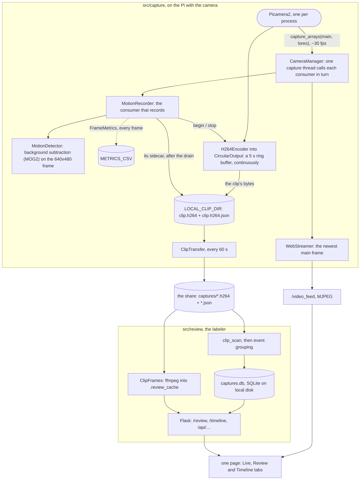
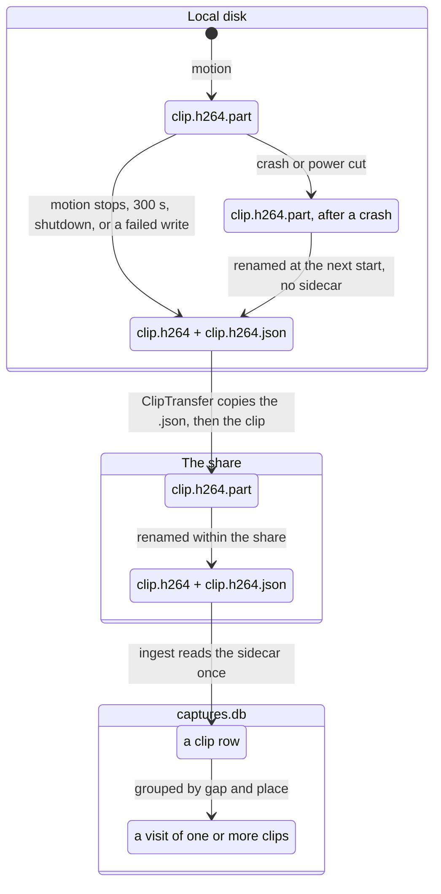
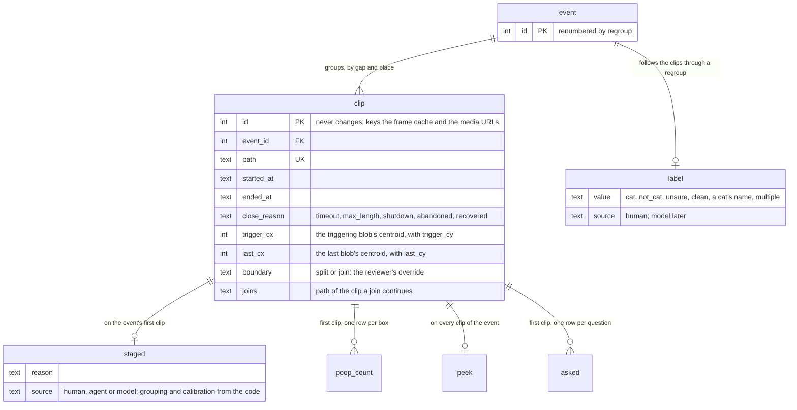
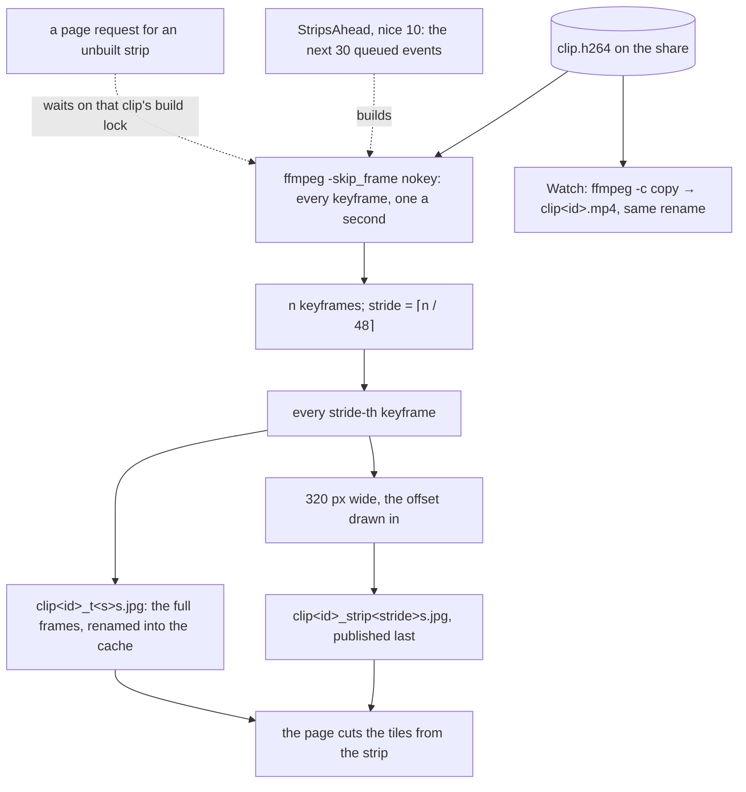

# Design

How the system works, and why it is shaped that way. Kept here so the source can stay terse.

This file is the map, readable in a few minutes: the goal, the whole system and its threads, then
a summary of each thing the system does, with a picture where there is a flow, a state machine or
more than one thread. Each summary ends with a link to the decisions behind it, in a document of
its own under [design/](design/): what was decided, why, and when it was measured, with the
numbers and failures that settled it. Read those before changing that part.

Decisions cite `ROADMAP.md` by section (A.2, A.4, B.5b, …). Words with a meaning of their own
(visit, event, sidecar, tile, …) are in the [Glossary](#glossary) at the end. The pictures are
Mermaid, which GitHub renders in place; a box or an arrow in one is a claim about the code, held
to the same standard as a sentence.

## Goal

**The point of the project is catching bowel or urinary trouble in a cat.** Knowing which cat
made a visit is the way there, not the goal itself. Three things follow from it:

- **Recall comes first.** A missed visit leaves a gap in a cat's record. A gap can look like the very
  change the project exists to flag, so losing a visit can lead to wrongly flagging a healthy cat. An
  extra clip only costs review time.
- **A visit may span several clips.** It is fine to stop recording while nothing is truly moving, for
  example while a cat sits still in the box, as long as the clips on either side of the pause are
  linked to the same litter-box event. One clip does not have to stay open through the stillness.
  Clips are linked into events at ingest; see From clips to events below, and ROADMAP A.4.
- **Poop versus pee is a possible later step.** Telling them apart looks hard and error-prone, so
  nothing should depend on it.

## The system at a glance

One process on the Pi does everything, in two halves that share no objects. The capture half owns
the camera, decides when something is moving and writes clips to local disk; the review half reads
those clips back from the share, groups them into visits and serves the page a person labels them
on. The whole contract between the halves is a clip and its sidecar (a small JSON file of what the
video cannot say: when, where in the frame, why it ended) on the share, so either half can change
without the other noticing.

The review half imports without the camera stack, and a lint rule (`TID251`, which bans `picamera2`
outside `src/capture/`) keeps that true, so the tests run on any machine. `check_page.py` serves
the page with no camera attached; it builds the whole web app, so it needs `picamera2` installed.
The service itself needs a camera: `main.py`, its only entry point, opens one first.

Two things in the picture carry most of the weight. The camera's frames take two independent
paths: the fan-out, on one capture thread, feeds detection and the live view, while the recorded
bytes go through picamera2's own encoder into a ring buffer that the recorder diverts to a file
when motion starts; changing frame distribution does not change what is recorded, and vice versa.
And nothing on the capture side writes to the share: clips land on local disk
and `ClipTransfer` ships them on its own thread, so the camera never waits on the network and
recording survives an outage of the share. Each half keeps its own state on local disk, the clip
cache on one side and the database and frame cache on the other; the share holds only the clips.

The code follows the same split. `src/web_app.py` assembles the one Flask app from both halves,
`src/logging_setup.py` configures logging, and `main.py` is the only entry point.

| package | holds | may import |
|---|---|---|
| `src/capture/` | everything that touches the camera: `camera_manager`, `motion_detector`, `motion_recorder`, `motion_metrics`, `clip_transfer`, `capture_heartbeat`, `web_streamer` | `picamera2`, `src.clips` |
| `src/review/` | everything that reads the share and serves the labeler: `clip_scan`, `capture_db`, `event_grouping`, `clip_frames`, `strips_ahead`, `timeline`, `api`, `calibration` | `src.clips`, never `picamera2` |
| `src/clips/` | what both sides agree a clip is: `format` (suffixes, `partial_name()`, `CAMERA_FPS`, `H264_BITRATE`, `ANALYSIS_SIZE`), `sidecar`, `blob`, `frame` | the standard library and numpy only |

The 6 decisions behind it, with their evidence:
[design/system.md](design/system.md#the-system-at-a-glance).

## Threads and locks

The process runs about ten threads. The table is the map: what each one does, which locks it
takes and what it must never do. The entries under it are the measurements and failures that put
each rule there.

| Thread | Runs | Takes | Must never |
|---|---|---|---|
| main | `main.py`'s setup, then `monitor()`: once a second, how old is the last frame; the shutdown | — | — |
| capture (`CameraManager._distribute_frames`) | `capture_arrays` for both streams, then every consumer in turn: `MotionRecorder._process_frames` (detect, open or close a clip) and `WebStreamer._consume_frames` (copy the frame) | `_frame_lock` around the capture alone; `WebStreamer.frame_lock` for one assignment | wait on a disk, the network or another thread. A consumer that blocks it stops detection, and after 10 s the process restarts |
| picamera2's output thread: the camera event loop on a Pi 5, `V4L2Encoder.thread_poll` on a Pi 4 | the H.264 encode of every `main` frame and every write of clip bytes, through `_ResilientCircularOutput` | `Picamera2.lock`, the encoder's lock, `CircularOutput._lock` | raise, which ends the loop and freezes capture; write anywhere but local disk |
| drain, one per clip end (`MotionRecorder._finish_clip`) | `CircularOutput.stop()`: the ring written out, then the sidecar, then the rename | `CircularOutput._lock` for the whole drain, which the output thread waits on | write to the share |
| metrics writer (`MetricsLog`) | rows off a bounded queue into the CSV | — | block the capture thread: a full queue drops the row |
| `ClipTransfer` | every 60 s, copy finished clips to the share, sidecar first | — | nothing; it is the one capture-side thread that may block on the share |
| `CaptureHeartbeat` | one GET a minute, 10 s timeout, while the last frame is under 10 s old | — | log the URL |
| Flask server (`app.run`, on a daemon thread `main.py` starts) | accepts connections and hands each to a request thread | — | — |
| Flask request threads (`threaded=True`) | the pages, the review API, and one `generate_frames` generator per live viewer | `CaptureDB._lock`, an `RLock` around its one SQLite connection, through `@serialized`; a per-clip build lock in `ClipFrames` | hold `CaptureDB._lock` while reading the share; hold `WebStreamer.frame_lock` across a `yield` |
| `startup-ingest` | one scan of the share when the process starts | `CaptureDB._lock` only to insert what the scan found | — |
| `strips-ahead`, reniced to 10 | the strips of the next 30 queued events, one clip at a time | `CaptureDB._lock` to read the queue; the clip's build lock | hold the database lock while ffmpeg runs |
| stall deadline (`threading.Timer`) | `os._exit(1)` 60 s after a stall, if the cleanup has not finished | — | — |

Across processes, every open `CaptureDB` holds a shared `flock` on `<database>.lock`, and
`regroup` takes it exclusive.

The rule the table enforces: the two threads the camera depends on, the capture thread and
picamera2's output thread, wait on nothing that can stall: not a network share, not another
thread, not a lock held across I/O. Everything that can block, the share, ffmpeg, HTTP, the CSV,
has a thread of its own, and the review side does its share I/O with no database lock held.

The 7 decisions behind it, with their evidence:
[design/system.md](design/system.md#threads-and-locks).

## Capturing frames

`CameraManager` configures two streams from the one sensor: `main` at 1280x720 for the recording
and the live view, `lores` at 640x480 (`ANALYSIS_SIZE`) for detection, from the full array binned
2x2. One blocking `capture_arrays` call a frame returns both, which paces the loop at the sensor's
~30 fps, and the consumers, registered with `add_consumer`, run one after another on that
thread.

The 4 decisions behind it, with their evidence:
[design/capture.md](design/capture.md#capturing-frames).

## Detecting motion

Every `lores` frame is measured the same way whether or not metrics are being logged, and the
trigger decides from that measurement. MOG2 holds the background model; the pixels it marks as
foreground rather than shadow are counted, and their largest region is kept both raw and after a
morphological clean-up. The trigger is the count against `MOTION_THRESHOLD`, gated by a warmup
and by the frame's brightness; the cleaned blob is what the sidecar records.

The settings an installation tunes, `MOTION_THRESHOLD`, `MOTION_TIMEOUT`, `MOG2_HISTORY` and
`DARK_BRIGHTNESS`, come from the environment and reach the detector, or for `MOTION_TIMEOUT` the
recorder, as constructor arguments.
Calibration, at the end of this document, is how a data run turns into their values.

The 9 decisions behind it, with their evidence, and an example of the metrics CSV:
[design/capture.md](design/capture.md#detecting-motion).

## Recording and shipping a clip

The encoder runs continuously into a five-second ring buffer, and nothing reaches disk until
motion starts. From there a clip's life is a sequence of renames, each atomic because it stays
within one filesystem, and only a final name means complete: that holds on local disk, where the
recorder writes, and again on the share, where `ClipTransfer` copies to. The facts the raw stream
cannot carry, when the clip started and ended, where the cat was and why the clip closed, travel in
a sidecar that is written before the clip takes its final name and copied before it.

`MotionRecorder` diverts the ring with `_ResilientCircularOutput.begin(<.part path>)`: from the
next frame on, the file starts at the ring's oldest keyframe and the ring drains a frame for
every frame that arrives, until `stop()` writes out what remains. `ClipTransfer`'s scan is
stateless: each pass ships whatever finished clips it finds, so one stranded by a crash ships on
the next.

The 12 decisions behind it, with their evidence, and an example of a sidecar:
[design/capture.md](design/capture.md#recording-and-shipping-a-clip).

## Running as a service

The detector runs as the `catdetector` systemd unit, built from `deploy/catdetector.service.in`.
`main.py` builds the pieces in an order that lets each fail without taking the rest down, then
`monitor()` blocks on the main thread watching the age of the last frame. There are three ways
out, and they differ in the exit code, which is what tells systemd whether to restart.

The 9 decisions behind it, with their evidence:
[design/service.md](design/service.md#running-as-a-service).

## From clips to events

Ingest registers each clip once, from its sidecar, and groups clips into events: one visit, one
or more clips, chained by `event_grouping`'s rule when a clip starts within `EVENT_GAP_SECONDS`
of the previous clip's end and within `EVENT_BOX_DISTANCE_PX` of where that clip left the cat.
Event ids survive a rescan but are rebuilt by `regroup`, while clip ids never change. So every
fact that must outlive a change of thresholds hangs off a clip: a reviewer's split or join, a
staging, a poop count, a peek, a frame cache entry; and labels, keyed by event, are remembered per
clip through a regroup and restored where an event's clips agree.

The bookkeeping columns (`created_at`, `labeled_at`, `staged_at`, `noted_at`, `asked_at` and
`size_bytes`) are left out of the picture.

The 15 decisions behind it, with their evidence:
[design/events.md](design/events.md#from-clips-to-events).

## Showing a clip

A clip is a raw H.264 stream on a CIFS share, so the page never reads one directly. `ClipFrames`
decodes it once with ffmpeg, keyframes only, into a strip of captioned tiles and the full frames
behind them, published into `.review_cache` by rename so a half-written entry is never served;
Watch remuxes it to MP4 the same way. `StripsAhead` does that work before the page asks, at low
priority, for the next thirty events in the queue.

The 9 decisions behind it, with their evidence: [design/review.md](design/review.md#showing-a-clip).

## The review page

One Flask app on one port serves one template (`src/templates/app.html`) with three tabs: Live,
the MJPEG feed (`/video_feed`) and the recorder's status (`/api/status`); Review, the labeler;
and Timeline, brushable strips of counts by day and hour.
The script is ES modules with no build step: one per tab, `app.js`, which switches the tabs, and
`common.js`. The server owns every
rule that would otherwise exist twice, such as the timeline's filter; the browser owns position,
which lives in the address, and the undo history. A change to the page is checked by looking at
it: `tests/manual/check_page.py` screenshots it at a phone's size and a laptop's.

The 16 decisions behind it, with their evidence:
[design/review.md](design/review.md#the-review-page).

## Calibration

A data run ends in `main.py --calibrate`, which reads the run's metrics CSV and the review
database, proposes the trigger settings and stages for review what it cannot decide.

The 9 decisions behind it, with their evidence:
[design/calibration.md](design/calibration.md#calibration).

## Glossary

The words this project uses with a meaning of their own. Prose and code spell them the American
way (labeled, color, gray), as `?filter=labeled` and `labeled_at` always have.

**Visits and events**

| term | meaning |
|---|---|
| visit | One cat's use of the boxes, from coming in to leaving: what the project counts. A peek is not one. |
| event | The clips grouped as one visit, or as whatever else moved: the unit that is labeled. Its id can change on a regroup. |
| clip | One recording, a raw H.264 file (`.h264`), from just before motion started until `MOTION_TIMEOUT` after it stopped, at most 300 s. |
| sidecar | `<clip>.h264.json`, beside each clip: its start and end, its trigger and last blobs, and its close reason. |
| close reason | Why a clip ended: `timeout`, `max_length`, `shutdown`, `abandoned` (writes failed partway) or `recovered` (no sidecar: a crash cut it off). |
| pre-roll | The footage a clip holds from before its trigger: up to 5 s from the ring buffer, less if the previous clip ended more recently. |
| grouping | The rule that adds a clip to the visit that ended within `EVENT_GAP_SECONDS` of its start, in the same place (`EVENT_BOX_DISTANCE_PX`). |
| regroup | `main.py --regroup`: rebuild every event from the current settings. Event ids change; labels and marks follow their clips. |
| split, join | A reviewer's override of the grouping, stored on the clips: a new visit starts at this clip, or this clip continues that one. Both survive a regroup. |
| box | A litter box. In the data, a position: a third of the analysis frame, numbered 1 to 3 from the left (until roadmap C.3). |

**Labels and review**

| term | meaning |
|---|---|
| label | The verdict on an event: a cat's name, `cat` (which one not decided), `multiple`, `not_cat`, `unsure` or `clean`. |
| peek | A mark beside a cat's label: the cat looked in and used no box. The event keeps the cat, and is not counted as a visit. |
| cleaning | An event labeled `clean`: a litter scoop, with the poops found in each box, read from the hand signal. |
| review queue | Every unlabeled event and every staged one, oldest first: the Review tab's default walk. |
| staged | Sent back to the review queue with a reason and a source (a person, an agent, a model, or the grouping or calibration code). A staged event keeps its label until a label press confirms or replaces it. |
| walk | The run of events the Review tab steps through: the review queue, or a filter (`multi`, `labeled`, or one label). |
| tile | One still of a clip on the review page: a keyframe, one per second of the file (fewer past 48), with its offset drawn in. |
| strip | One image per clip holding all its tiles side by side; the page cuts the tiles from it. |
| strips ahead | Building the strips of the next 30 queued events in the background, so the page rarely waits for one. |

**Detection**

| term | meaning |
|---|---|
| analysis frame | The 640x480 `lores` stream that detection runs on. Recording and the live view use the 1280x720 `main` stream. |
| consumer | A function the capture thread calls with every frame (`add_consumer`): the detector's and the live view's. |
| background model | MOG2's picture of the empty scene, learned over `MOG2_HISTORY` frames. A cat that sits still fades into it. |
| foreground | The pixels that differ from the background model, shadows excluded. Their number, the foreground count (`foreground_px`), is what triggers a clip today. |
| blob | The largest connected region of foreground in a frame. The cleaned blob (`clean_blob`) is the same after removing speckle and joining nearby pieces. |
| trigger | A frame whose foreground count is over `MOTION_THRESHOLD`. The first one starts a clip; each one keeps it open. |
| warmup | The first 30 frames after a start, ignored while MOG2 learns the scene. |
| dark gate | Motion is ignored while the analysis frame's mean gray level is below `DARK_BRIGHTNESS`. |
| visit strength | The largest cleaned blob a visit reaches. The weakest visit sets how low a trigger has to reach. |

**Running and calibrating**

| term | meaning |
|---|---|
| installation | One setup: a Pi, its camera and how it is mounted, the boxes, the lighting and the cats. Thresholds belong to an installation. |
| data run | A week or two of recording at a low threshold with `METRICS_CSV` on, labeled by hand, to calibrate an installation. |
| metrics CSV | A row of detection measurements per frame, written while `METRICS_CSV` is set. |
| calibrate | `main.py --calibrate`: a data run's progress, its doubts staged for review, and the settings it proposes. |
| share | The mounted filesystem finished clips go to (`NETWORK_SHARE_DIR`): a NAS, another computer's share or a USB disk. |
| ring buffer | The encoder's last 5 s of video, held in memory until motion diverts it into a clip. |
| ingest | Reading new clips and their sidecars from the share into `captures.db`, and grouping them. |
| capture stall | No frame from the camera for 10 s. The detector exits and systemd restarts it. |
| capture heartbeat | A URL pinged once a minute while frames arrive, for a check outside the project that alerts when the pings stop. |
| drop-in | A systemd override file (`systemctl edit catdetector`) holding one installation's run settings. |
