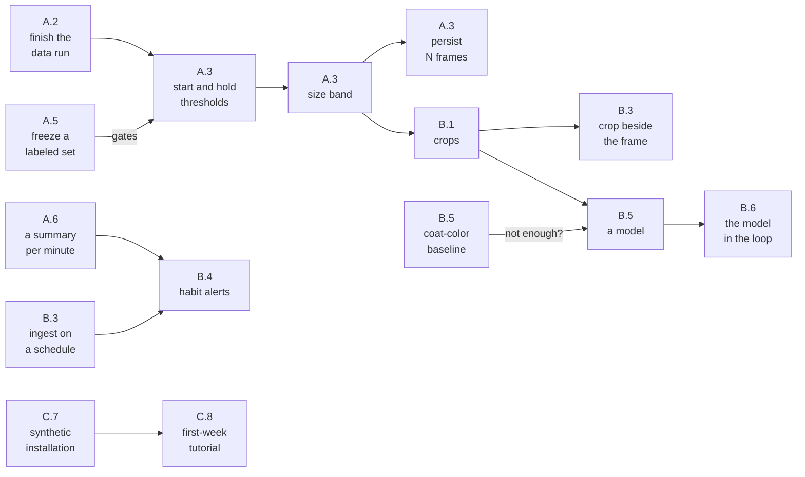

# Roadmap: cat detection and identification

This file holds the plan as it stands: what is decided, what is next, and what
is still open. Finished items and the history behind decisions move to
`ROADMAP_ARCHIVE.md`, under the same section letters, so a citation such as
"A.2" finds the plan here and its history there.

**Goal.** Spot bowel or urinary trouble in a cat. That means reliably recording
every litter box visit and knowing **which cat** made it. Telling poop from pee
might come later, but it looks hard and unreliable, so nothing depends on it.

Two workstreams, in dependency order, and a third that runs alongside both:

- **Part A — trigger reliably.** A cat entering the frame always starts a
  recording. Recall is the priority: a missed visit is a failure, an extra clip
  is an annoyance.
- **Part B — identify the cat.** Collect and label enough images to train a
  per-cat classifier, which needs a labeling workflow before it needs a model.
- **Part C — any installation.** Someone else's cats, boxes, camera, Pi and
  storage should work as well as the ones this was built on, with the hardware
  behind interfaces and nothing about one home written into the code.

Part B depends on Part A's bounding box: the box that decides "this is
cat-sized" is the same box that crops training images. Do not build the crop
pipeline twice.

## Where things stand

As of 2026-10-08.

**Built:**

- recording on motion, with the seconds before it, shipped to the share and kept
  going through its outages;
- a restart, and an optional alert, when the camera stalls (A.6);
- clips grouped into visits, with split and join (A.4);
- the review page with the cats' names, peeks, cleanings and the review queue
  (B.3);
- the timeline (B.6);
- `--calibrate`, which counts a data run and proposes its settings (A.2);
- checks that hold the documents to the code: links, citations, settings and the
  figures they quote (C.8).

**Under way:**

- the data run that gives the first calibrated threshold (A.2);
- a CI job that installs from the README on a clean Debian, waiting for its
  first run on GitHub (C.8).

What the open items wait on, as their entries below state it (an arrow points at
the item that needs it):

Waiting on nothing: A.3's locked exposure; A.4's grouping thresholds and boxes
where the cat stayed; B.2's cache pruning, database backup and SD wear; B.5b's
counts beside visits; B.6's touch test of the timeline; every other item in Part
C; and retention (Risks).

**What every installation needs.** A fixed camera mounted overhead, pointing
straight down at the litter boxes, and **the boxes lit around the clock**: the
camera sees nothing in the dark, and constant light is what made nights record
like days. Because the camera never moves and the boxes are a fixed distance
away, a cat's apparent size in pixels is roughly constant. That is the most
useful fact available, and the trigger does not use it yet (A.3). The number of
boxes, where they sit and how many cats use them are the installation's, not the
project's (C.3).

Measurements in this roadmap come from one installation, a Raspberry Pi 5 with
the IR-filtered Camera Module 3; Part C is about not mistaking it for a
requirement.

**Hardware split.** The Pi captures and another machine trains, with the crops
and labels on the share as the handoff to whatever trains (B.5); frames never
leave the Pi.

**Platform.** A Raspberry Pi 5 with no accelerator, so any *on-Pi* inference
would be CPU. The share is typically **CIFS**, which is why SQLite stays local
(B.2). A training machine keeps its own environment: on a Jetson, JetPack pins
its own Python (3.10 on JetPack 6) and PyTorch comes from NVIDIA's wheels, so it
should not try to share this repo's `==3.13.*` pin.

**Thermal headroom.** A fanless Pi 5 throttles under the detector at 84–86 °C;
with the Active Cooler it holds 46–55 °C. Any extra on-Pi work, including
inference for B.5, has to fit in the headroom that leaves; measure it before
assuming there is any.

---

# Part A — trigger reliably

## A.0 Where detection stands

`MotionDetector.detect` (`src/capture/motion_detector.py`) runs MOG2 on the
640x480 lores frame, drops MOG2's shadow pixels, and calls the frame moving when
the foreground pixel count exceeds `MOTION_THRESHOLD`. It is gated off during
MOG2's warmup and while the frame's mean brightness is below `DARK_BRIGHTNESS`.
Every frame is also measured for a cleaned blob (morphological open and close,
then the largest contour), which the metrics CSV logs and the sidecar records,
but which does not yet decide anything.

| setting | default |
|---|---|
| `MOTION_THRESHOLD` | 300; a data run sets it lower (A.2) |
| `DARK_BRIGHTNESS` | 10 |
| `MOTION_TIMEOUT` | 10 s |
| `MOG2_HISTORY` | 500 frames (~17 s) |

The boxes must be lit around the clock, so nights record like days. The camera
is IR-filtered and sees nothing in the dark; if the light fails, the dark gate
stops black clips but not the gap.

## A.1 What still stands between this and the goal

1. **No spatial coherence.** Scattered noise and one solid cat-sized blob are
   identical to a global count. A.3 fixes this.
2. **A stationary cat fades out.** MOG2 absorbs anything static in ~17 s, so
   recording can stop mid-visit. That is accepted: A.4 links the clips on either
   side into one event.
3. **False triggers.** Daylight, room light and people trigger clips that are
   labeled `not_cat`, and what triggered each one is not labeled. A size band
   with an upper bound (A.3) is the fix for the lighting ones.

## A.2 Measure before tuning

**A data run** comes first: the detector runs as the service with a low
`MOTION_THRESHOLD` and `METRICS_CSV` on, over-capturing rather than missing, so
a visit below the threshold still leaves a trace in the CSV. The trigger is
tuned to the weakest visit, not the average one, so the unit to collect is
**visits, not hours**. A visit's strength is the **largest** cleaned blob it
produces, not the blob that started its clip: a band that ignores a cat's head
peeking in at the frame's edge still fires a second later when the whole cat
steps in, so what decides recall is whether a visit ever reaches the band. A
dark or low-contrast coat on the litter is the weak case, since its cleaned blob
breaks into pieces. Only visits recorded once the setup has settled (lighting,
framing, sensor mode) count; earlier ones are a different regime. The run stops
when every condition below holds.

| condition | why |
|---|---|
| **50+ labeled visits, 100 preferred** | zero misses in 50 only bounds the miss rate at ~6% (95%); at 100, ~3% |
| **10+ at night under the light** | more sensor gain, more noise: a different regime |
| **15+ per cat** | a dark cat on dark litter gives a weaker signal than a pale one |
| **every box used** | a far box covers fewer pixels and may read weaker |
| **several days of varied weather, one overcast**, unless the boxes' own light swamps daylight | lighting changes are a daytime false trigger (A.1) |
| **the weakest visit has stopped getting weaker over the last ~20 visits** | the band's lower edge follows the weakest visit |

How each condition is counted is `--calibrate`'s, in
`docs/design/calibration.md`. False positives are measurable from hours rather
than visits, and any candidate rule can be replayed against the metrics CSV
without re-recording. Storage is not the constraint (the metrics CSV grows by
roughly 150 MB a day). **Labeling is**: each day's events have to be kept up
with, or the backlog outlives the run. `main.py --calibrate` counts the
conditions, stages what needs a second look and proposes the settings (archive,
A.2).

- [ ] **Finish the data run** against the table above.
      **Done means** `--calibrate` reports every condition met, and the
      service's drop-in takes the threshold it proposes, without `METRICS_CSV`,
      in the change that ticks this box.

## A.3 Detect a cat-sized thing, not "some pixels changed"

The cleaned blob is already measured on every frame (A.0); what is left is
making it the trigger.

- [ ] **Start and hold thresholds.** One threshold both starts a clip and keeps
  it going, so
      raising it to cut false triggers also closes clips while a cat sits still.
      Start a clip above `MOTION_THRESHOLD` and keep it recording while the
      foreground count stays above a lower `MOTION_HOLD_THRESHOLD` (by default
      equal, which is today's behavior). Replayed on one run (2026-10-03), a
      start of 2876 with a hold of 150 missed no visit, kept the median visit
      100 % recorded, and cut false triggers from 1.68 to 0.76 an hour and clips
      from 898 to 494; 2876 alone recorded 84 %, and the size band below managed
      0.82 an hour. **Done means** `MotionDetector` takes both, a test shows a
      count between the two neither starting a clip nor letting a running one
      close, `--calibrate` proposes the pair, and its replay of the pair misses
      no labeled visit.
- [ ] Trigger on a **size band** (`min_cat_area < area < max_cat_area`) from
  A.2. The upper
      bound rejects lighting changes: a cat cannot be 60% of the frame. The band
      is only defensible because the overhead mount keeps apparent size
      constant. **Done means** `MotionDetector` starts a clip on a cleaned blob
      inside the configured band and not on the global count, tests cover a blob
      just inside, just below and just above the band, and `--calibrate`'s
      replay over A.5's set misses no labeled visit. Measure it after the hold
      item: on one run it beat a calibrated threshold only narrowly (0.82
      against 0.91 false triggers an hour), and its upper edge came from
      exposure shifts, not a cat.
- [ ] Require the blob to persist N consecutive frames (keep N at 2-3 — recall
  matters more
      than precision). **Done means** N is a setting (default 2), a test shows a
      one-frame flicker inside the band starting nothing and N frames starting a
      clip, and `--calibrate`'s replay at that N misses no labeled visit.

- [ ] **Lock exposure and white balance.** The camera re-exposes as a dark cat
  crosses the frame,
      and the shift reads as foreground across the scene: on one run, blobs of
      30,000 to 89,000 px came with it, while a cat leaping out of a box reached
      about 26,000. Under the constant light the boxes need anyway, fixed
      exposure and color gains (picamera2's `AeEnable` and `AwbEnable` off, with
      values taken from the light) should remove that class of false trigger.
      **Done means** a setting fixes them, a week runs with it, and
      `--calibrate` shows the strongest visit and the false triggers an hour
      before and after.

The box the trigger computes is the one B.1's crops are cut from; Part B needs
it as the training crop, so it is not computed twice.

## A.4 One visit, one event, even across several clips

Recording may stop while a cat sits still, **as long as the clips before and
after the pause are linked to the same litter-box event**. Built: a sidecar of
facts per clip, the grouping rule (`src/review/event_grouping.py`), the
clip/event schema with `--regroup`, and split and join in the review page,
stored as overrides a regroup respects. The design is in `DESIGN.md`; the plan
as agreed is in the archive.

- [ ] **Choose the thresholds from labeled events**, then `--regroup` and audit
  with
      `filter=multi`. `EVENT_GAP_SECONDS` (180) and `EVENT_BOX_DISTANCE_PX`
      (120) are starting guesses. Too small a gap splits a visit (double-counts
      frequency, shortens duration); too large merges two cats' visits (the
      labeler marks it `multiple`). The frequency signal is the point of the
      project, so lean toward merging. If two boxes prove too close for a
      centroid distance, replace it with a fixed rectangle per box in lores
      coordinates. **Done means** both are set from measured distributions (gaps
      between clips inside single-cat events against gaps between consecutive
      events; centroid distances within and between boxes), the numbers are in
      `docs/design/events.md`, `--regroup` has run, a walk of `?filter=multi`
      finds no event merging two visits, and a walk of one day's events in order
      finds no visit split in two. The first data (2026-10-03): the twelve joins
      reviewers made had gaps of 0 to 141 s, mostly 17 s or less, and centroid
      distances of 185 to 295 px, all past 120 and half across a box boundary,
      while different cats followed each other as closely as 13 s, so neither a
      wider distance nor "same box" alone separates them.
- [ ] **An event's boxes are where the cat stayed.** The timeline's box column,
  and anything
      counted per box, reads the third holding the first clip's trigger, which
      is mostly where the cat came in (A.2's measurements). The recorder writes
      the seconds the cleaned blob spent in each box into the sidecar, ingest
      stores them per clip, and an event's boxes are those with 10 s or more;
      the timeline shows every one, so a visit to two boxes is counted in both.
      **Done means** the sidecar carries seconds per box, the timeline filters
      and shows by them, and tests cover a visit that moves between two boxes
      and one that only passes through a third.

Known limit: two cats in different boxes at the same moment land in one clip,
because detection is a global count. Grouping cannot separate them; that is what
the `multiple` label is for. One clip can also cross from one box to another,
and grouping places a clip by its trigger position.

## A.5 Verify against the goal

Score on **recall first**, false-positive rate second. A change that trades
recall for precision is a regression for this project. The labeled `captures.db`
is the regression set; what it lacks is a frozen list, so later relabeling does
not move the goalposts; a finished data run's labeled visits are enough to
freeze. `--calibrate`'s replay does the scoring, against the metrics rows rather
than the video.

- [ ] **Freeze a labeled set and gate detection changes on it.** Clips labeled
  cat / no cat /
      ambiguous, listed by clip name, since event ids change on a regroup. The
      list is one installation's data, so it lives beside the database, not in
      the repository. **Done means** the list exists, `--calibrate`'s replay
      scores a candidate detector against it, and A.3's change is accepted only
      if recall on the set does not drop.

## A.6 Keep capturing

A trigger that works is no use while the camera delivers no frames. The camera
can stall: libcamera logs "Camera frontend has timed out" and `capture_arrays()`
blocks from then on without raising. The process stays alive, so systemd's
`Restart=on-failure` never fires; the web server keeps answering `/api/status`,
and nothing alerts. A restart brings the camera back at full rate, and the
shutdown has been seen to complete with the camera still wedged. In normal
running, the longest gap between frames outside a restart or power-off measured
under 2 s.

Both halves are built (archive, A.6): after 10 s with no frame the detector
exits non-zero through its usual cleanup, so systemd restarts it, and an
optional `CAPTURE_HEARTBEAT_URL` is pinged only while frames arrive, for a dead
man's switch set up outside this project.

- [ ] **A summary per minute.** Once a data run ends, `METRICS_CSV` is off and a
  visit the trigger
      missed leaves no trace. One row a minute, kept on local disk and read into
      `captures.db`: frames received, the largest foreground count and cleaned
      blob, and the brightness. It gives B.4's rule the hours the camera was
      recording, and a minute whose largest count came within half of the
      threshold without starting a clip is a near miss to list for review.
      **Done means** the rows are written without `METRICS_CSV`, B.4 reads its
      recorded hours from them, the review page lists near misses for the last
      week, and a test shows a minute of no frames counted as a gap rather than
      as a quiet minute.
- [ ] **A shipped clip is never overwritten.** Clips are named by their local
  start time, and
      the recorder avoids only a name still on local disk. A shipped clip is
      gone from there, and `ClipTransfer` replaces a file of the same name on
      the share, so across the daylight-saving fall-back a clip that starts in
      the repeated hour can overwrite one from the hour before, sidecar and all.
      C.6 removes the cause; this closes the loss until then. **Done means**
      `ClipTransfer` never replaces a clip or a sidecar on the share: a second
      clip of one name ships under a free name with its sidecar beside it, and a
      test ships two clips that share a name.

---

# Part B — knowing which cat

## B.1 Capture the right data

A classifier trains on stills, not clips. The per-clip facts are already kept:
the sidecar holds each clip's times and its trigger and last blobs with their
boxes, the `clip` table its times, path and the blobs' centroids, and the review
side takes full frames from the clip itself. What is missing is the crops:

- [ ] **Crops with their boxes, stored per event.** A handful of JPEG crops per
  event, cut from
      A.3's bounding box (the cat), not the whole frame. Several frames spread
      across the event, not one — pose varies, and variety is what makes the
      classifier generalize. Each crop is a row in a `crop` table with its
      event, clip, path on the share, frame time and box (B.2). **Done means**
      every event recorded after the change has between K and M crops on the
      share (K and M settings), spread over its duration, each row carrying the
      box its crop was cut from; ingest fills the `crop` table from the share
      the way it fills `clip`, `--regroup` keeps crops with their clips, and a
      test with the fake camera shows a 20-second visit yielding crops from its
      start, middle and end that read back by event.

**Model the data as events, not frames.** One visit = one event = one or more
clips (A.4) and many crops. This is the single most important structural
decision in Part B, for two reasons:

- **Labeling cost.** A human labels the *event* once ("that's Cat A"), and the
  label propagates to every crop from it. Labeling frame-by-frame is 50x the
  work for the same information.
- **Honest evaluation.** Crops from one event are near-duplicates. Splitting
  train/val randomly *by crop* leaks the same cat-in-the-same-pose into both
  sides and inflates accuracy badly. **Split by event** (ideally by day). Decide
  this now; it is painful to retrofit once a model looks deceptively good.

Two cats in one event are labeled `multiple`, which excludes the event from
single-label training rather than silently mislabeling it.

## B.2 Storage

SQLite on local disk (`captures.db`), media on the share; never SQLite on the
CIFS share, and never image blobs in SQLite. The built tables are in
`src/review/capture_db.py`: `event`, `clip`, `label`, `poop_count`, `staged`,
`peek` and `asked`, and B.1 adds `crop`. `label` is a table of its own, but its
key is the event, so an event holds one label: model predictions (B.6) need a
key of `(event_id, source)` or a table of their own before they can sit beside
the human labels.

- [ ] **Prune `.review_cache`.** It keeps every strip, up to 48 full frames (~4
  MB) per clip and
      a remuxed MP4 per watched clip, and nothing ever removes them; on a small
      SD card it eventually reaches the recorder's 1 GB free-space floor and
      recording stops. Give it a size budget (configurable, a sensible share of
      the disk by default) and evict least recently used entries past it, oldest
      first; everything in it can be rebuilt from the clip. **Done means** a
      test fills the cache past its budget and sees it shrink below it without
      touching the entries the page is showing, and the README says what the
      budget is.
- [ ] The DB is the only thing that is hard to recreate, so it is the thing to
  back up.
      **Done means** the service writes a consistent copy of `captures.db`
      (SQLite's backup API, not a file copy) to a configurable destination on a
      schedule, a test restores one and reads back its labels, and the README's
      Settings section says where the copy goes and how to restore it. A
      finished copy on the share is fine; the live database never is.
- [ ] Watch SD-card wear: many small writes. Batch inserts per event rather than
  per frame.
      **Done means** the bytes written to the SD card in 24 h of normal running
      are measured (`/sys/block/mmcblk0/stat`), the main writers are named in
      the design documents, and anything over a stated daily budget has an item
      of its own.

## B.3 Labeling UI

The Review tab labels at event level with one keystroke or one tap: the cats by
name (a digit key each, from `CAT_NAMES`), `cat` when which one is not decided,
`multiple`, `not_cat`, `unsure` and `clean`, with undo, live counts, `?filter=`
walks for auditing, an address that holds the event and the walk, whole-clip
tiles built before they are asked for, split and join, watch, a phone layout, a
review queue that labeled events can be staged back into with a reason, and a
peek mark for a cat that looks in and uses no box. **The only requirement that
really matters is speed:** hundreds of events reviewed by one person means
labeling must be a single action, or it will not happen and the classifier never
gets its data.

Next:

- [ ] **Show the crop *and* the full frame** — a crop alone is often ambiguous.
  Needs A.3 and B.1.
      **Done means** the review page shows each event's crops beside a full
      frame from its clip, and `check_page.py` screenshots at both sizes show
      them without horizontal scroll.
- [ ] **New clips reach the review queue on their own.** The share is read only
  at startup and
      when someone presses "rescan clip directory", so a visit recorded while
      the page is open never appears and its strips are not built ahead. B.4's
      daily rule reads `captures.db`, so it needs the same. Ingest on a schedule
      from one thread of its own, every minute by default
      (`INGEST_INTERVAL_SECONDS`): `ClipTransfer` ships a finished clip within a
      minute, and globbing and statting 1,013 clips over CIFS took 0.22–0.29 s
      (three runs, 2026-10-05; it grows with the archive, and a new clip's
      sidecar is the only other read). A scan stalled on the share holds no lock
      today (`clip_scan` runs unlocked), and must not let a second scan start
      behind it. **Done means** a clip that lands on the share reaches the
      review queue within one interval, with no rescan and no restart, and has
      its strip built ahead; a test with a short interval shows that, and shows
      a stalled scan neither blocking review requests nor letting a second scan
      start; a Review tab showing an empty queue picks up the new event without
      a reload; and the interval is in the README's settings table, whose "New
      clips appear after a rescan" says instead when they appear.

Non-goals for v1: multi-user, accounts, editing bounding boxes by hand.

## B.4 Alerts

Only a change in a cat's habits sends an alert: visits per day, or time in the
box, moving out of that cat's usual range, including a cat that stops visiting.
A peek is not a visit (B.3). There is no push per visit. Visits are labeled in
sittings, not as they happen, so a push per visit would be noise (archive, B.4).

The rule runs on a schedule over `captures.db`, off the capture path. A gap in
the record (the service down, the Pi off, the light out) looks exactly like a
cat visiting less, so the rule must count only the hours the camera was
recording and say how many it had. Only the optional metrics CSV records those
hours today, so the detector must keep its own record of them. The transport is
optional, as the capture heartbeat is: the project runs without it and names no
service. **ntfy** suits it, one HTTP POST with no account; Pushover, a Telegram
bot, SMTP or a Home Assistant webhook would do as well.

- [ ] **Alert on a change in a cat's habits.** Litter box usage is the health
  signal, and catching
      bowel or urinary trouble is the goal. A stated rule, for example a cat's
      visits per day or median visit length outside its trailing four-week range
      two days running, with each day scaled by the hours recorded. The alert
      names the cat and the change and links to the timeline filtered to that
      cat (B.6). **Done means** the detector records the hours it received
      frames in `captures.db`, with or without `METRICS_CSV`; the rule runs
      daily over `captures.db`; a test over a seeded history fires on an
      injected rise, an injected drop and a cat that stops visiting, and not on
      normal variation or on a day the camera was down; a firing reaches a
      configured URL; and with no URL set, nothing is sent and nothing fails.

## B.5 Train the classifier

**Keep the training environment out of this repo.** A training machine's stack
may pin its own Python and PyTorch build, as JetPack does; a separate project on
the training machine that reads crops from the share is cleaner than widening
this repo's pins to straddle both machines. Any machine with a GPU, a Hailo
accelerator, or a CPU for a small model will do, and the handoff (crops and
labels on the share) is the only contract.

**Rough target:** several hundred to a low thousand crops per cat, spread across
many distinct events, days, and lighting conditions. Event count matters more
than crop count; 1000 crops from 5 visits is 5 examples. Split by event or day,
never by crop (B.1). Expect **heavy class imbalance** — cats seldom use the
boxes equally often — and weight the loss or resample rather than letting the
majority cat dominate. "Not a cat" negatives come free from false triggers; keep
them, they are real data.

- [ ] **Baseline first:** before any neural net, check whether mean coat color
  inside the mask
      separates the cats. A top-down view preserves a coat's pattern and color
      best; if color alone separates the cats, that is a few lines of OpenCV and
      no training loop. **Done means** a script reports, for the labeled
      single-cat events, how well mean coat color inside the mask separates the
      cats (a confusion matrix on events held out by day), and the result, with
      the decision it drives, is in the design documents.
- [ ] **Otherwise, a model:** transfer learning on a small backbone (MobileNetV3
  /
      EfficientNet-lite) over the crops, trained off the Pi. Decide where
      inference runs once there is a model to measure: on the training machine
      for accuracy headroom, or exported (ONNX/TFLite) back to the Pi so a visit
      can be classified without a second box in the loop. A small classifier on
      one crop per event is cheap either way. **Done means** a model trained in
      the separate project, from the crops and labels on the share, classifies
      events held out by day at a stated per-cat accuracy, and where inference
      runs is decided from a measurement of it, recorded in the design
      documents.

## B.5b Ground truth at cleaning time: the hand signal

**At cleaning time, hold a hand over the box just cleaned, fingers extended for
the number of poops found.** The scoop-out is recorded anyway, so the count
lands in the footage at the moment and place of the observation, with no
notebook, phone or app in the loop. The reviewer labels the event `clean` and
enters a count per box.

It is ground truth for the actual goal: combined with per-cat visit counts, a
count per box per cleaning gives the bowel signal statistically — a cat whose
visits hold steady while the counts fall is the case worth flagging. Counts
cannot be reconstructed from old footage, so every cleaning should carry one.

The convention, with the reason for each rule, is in the README (Labeling
visits, Cleanings).

- [ ] A view over time of counts per box, beside visit frequency per cat (B.6).
      **Done means** B.6's timeline filtered to `clean` shows each cleaning's
      counts per box, a chart of counts per box per week sits beside visits per
      cat per week, and a test over a seeded database checks both.

Not pursued: counting urine clumps the same way. They could not be validated
with this setup, so the urinary side of the goal rests on visit frequency and
duration per cat (B.6).

## B.6 The payoff

- [ ] **A timeline of every event**, filtered by label, day, hour and
  labeled-before, that
      stages what it shows for review. Built: the Timeline tab (DESIGN.md, The
      review page); its spec is in the archive. **Done means** a reviewer drags
      a brush by touch on a phone, the one condition of the spec not yet met.
- [ ] Human-in-the-loop: the model labels, low-confidence events are staged into
  the review
      queue (B.3) with `source=model`, corrections feed the next training round.
      **Done means** the model's predictions are stored beside the human labels
      (B.2's key), predictions below a confidence threshold are staged with
      `source=model`, a confident one labels its event with no human step, and a
      human correction is in the next training set's export.

---

# Part C — any installation

The hardware, the layout and the numbers here are one installation's. Each item
below removes a place where that installation is written into the project, or
says plainly what another one needs.

## C.1 Hardware behind interfaces

- [ ] **The camera becomes an interface with one implementation.** What the
  capture side needs
      from a camera is small: a display stream and an analysis stream delivered
      to consumers, and an H.264 encoder writing into a ring buffer that can be
      diverted to a file. Write that down as an interface, move everything
      picamera2- and sensor-specific into one module that implements it for a Pi
      5 with the Camera Module 3 (the RGB888 analysis stream, the 2304x1296
      sensor mode, the software encoder), and narrow the `picamera2` lint fence
      from `src/capture/` to that module. A Pi 4 (which needs a YUV analysis
      stream and has a hardware encoder) or another camera then becomes a second
      module. A NoIR camera with an IR light would also arrive this way; it is
      not supported now, because it changes the night regime and the coat colors
      B.5 relies on, and it is untested. **Done means** `picamera2` is
      importable only in the implementation module, the rest of `src/capture/`
      is tested against a fake of the interface, and the docs name the Pi 5 and
      Camera Module 3 as that implementation rather than as requirements.
- [ ] **Confirm the Pi 5's encoder path with a stack trace.** CLAUDE.md and
  DESIGN.md state both
      paths from the picamera2 source: `V4L2Encoder.thread_poll` on a Pi 4, the
      camera event loop through `LibavH264Encoder` on a Pi 5. **Done means** the
      documented thread is the one a stack trace from a Pi 5 shows.

## C.2 What every installation needs

Nothing open; finished items are in the archive.

## C.3 Any number of boxes, anywhere, and more than one camera

- [ ] **No fixed number or layout of boxes.** Three are hard-coded today:
  `BOXES` in
      `src/review/timeline.py` (and `--boxes`' default), the cleaning form in
      `app.html` and `review.js`, and the tests. Boxes become configuration, per
      camera, so the cleaning form shows the installation's boxes and a fourth
      one's counts can be recorded. Event grouping already places clips by
      centroid distance, so it needs no box map.
- [ ] **More than one camera.** Boxes may be in different rooms. Each camera is
  a capture node
      with an id, in its clips' names and sidecars; clips go to one share under
      that id; one review server ingests them all; grouping and box numbers are
      per camera; the review page says which camera an event came from. A second
      Pi is a second node, not a second project.
- **Done means** for both: a test installation with two cameras and a different
  number of boxes in each ingests, groups and records cleaning counts correctly,
  and no code, test or doc outside configuration says "three".

## C.4 Calibration per installation

- [ ] **The pixel numbers are one installation's.** `MOTION_THRESHOLD`,
  `EVENT_BOX_DISTANCE_PX`, the
      blob kernels and A.3's future size band all depend on mounting height,
      resolution and the size of the cats. Label every default as "from one
      installation". `--calibrate` (A.2) proposes the threshold and replays the
      band; `EVENT_BOX_DISTANCE_PX`, `EVENT_GAP_SECONDS` and the blob kernels
      are still guesses with no procedure. **Done means** `--calibrate` also
      proposes the grouping thresholds from the joins and splits reviewers made,
      and every default says where it came from.

## C.5 Storage anywhere

- [ ] **Clips go to any mounted filesystem, or stay local.** The share does not
  have to be a NAS:
      another computer's SMB or NFS share, a USB disk or cloud storage mounted
      with rclone all work if they are a real mountpoint (so an absent mount
      cannot fill the SD card), rename within them is atomic (so no reader sees
      a half-written clip), and the review side can read them. Cloud mounts make
      strip building slow, since ffmpeg reads each whole clip. Add an explicit
      local-only mode, so a single Pi can record and review with no second
      machine; today a plain directory is refused and nothing reaches the review
      page. The README's `soft` mount advice is CIFS-only: NFS mounts `hard` by
      default, which stalls the transfer and review threads. **Done means** the
      README lists the destinations and their requirements, and a test runs the
      whole path in local-only mode.

## C.6 Times stored in UTC, shown in local time

- [ ] Everything stored records UTC with an explicit `Z` or offset: clip names,
  sidecars, the
      database, the metrics CSV. Everything a person reads shows local time in a
      readable form (the review page takes the browser's zone and locale; logs
      take the Pi's). This removes the daylight-saving collisions, which the
      recorder avoids today only on local disk (A.6), makes time-of-day analysis
      (B.6) independent of how the Pi's zone was set, and absorbs B.3's "Dates
      are machine-shaped". Existing data was written in the Pi's local time:
      ingest reads an unmarked time as local and converts it, and names already
      on the share stay as they are. **Done means** every stored time carries
      its zone, a test crosses both daylight-saving changes, and no page or log
      shows a raw ISO string.

## C.7 Choices to make options, flagged for the next developer

Each works for the setup it was built on and would bite someone else:

- [ ] The web port is fixed at 5000 (`src/web_app.py`); make it a setting.
      **Done means** `WEB_PORT` is read from the environment with 5000 as the
      default, the startup log and the README use it, and a test starts the app
      on another port.
- [ ] The service account needs the `video` group for the camera; say so in the
  README and in
      `install-service.sh`. **Done means** `install-service.sh` stops with a
      message when the account is not in `video`, and the README's install
      section says so.
- [ ] Cat names that collide with the page's counts (`total`, `multi_clip`) are
  accepted;
      refuse them the way `cat`, `multiple` and the walks `multi` and `labeled`
      are refused. **Done means** they are refused at startup from one reserved
      set that the page's filters and counts are built from, with a test per
      name.
- [ ] Digit keys stop at nine cats, and match `e.key`, so on AZERTY the digits
  need Shift. Match
      `e.code` for digits, and give a tenth cat a way in. **Done means** digits
      match `e.code` (`Digit1`…, `Numpad1`…), a tenth cat has a key or a picker,
      the help text says so, eslint passes, and the keys were pressed by hand
      with an AZERTY layout selected.
- [ ] **`tests/manual/check_page.py` needs one installation's data.** It serves
  a copy of the
      live review database and the live frame cache, so it runs only where a
      `captures.db` has been filled, and every screenshot it takes shows real
      footage and the real cats' names. That keeps any picture of the page out
      of the README. Give it a synthetic installation: a script that builds a
      few clips with ffmpeg (a drawn floor, three boxes and a cat-sized dark
      shape that walks in, sits and leaves), their sidecars, and a database
      holding an event of each kind (cats named Ada and Bea, `multiple`, a peek,
      a cleaning with counts, `not_cat`, a visit split over two clips, a staged
      event), and a `--fixture` option that serves it from a scratch directory.
      **Done means** `check_page.py --fixture` runs in a fresh clone with only
      ffmpeg and chromium installed; one command takes the Review tab at phone
      size and the Timeline at laptop size from it, and those screenshots are
      committed and shown in the README (outside `docs/`, which tracks only its
      documents); and a pytest test builds the fixture and ingests it, so a
      schema change that breaks it fails the gate rather than the next
      screenshot.
- [ ] `tests/manual/check_page.py` looks for `chromium` by that name; accept the
  other names
      Chromium and Chrome install under. **Done means** the script tries
      `chromium`, `chromium-browser`, `google-chrome` and
      `google-chrome-stable`, and names what it tried when none is found.

## C.8 Documentation a stranger can follow

The documents come in tiers: the README, DESIGN.md's map, and the decisions
under `docs/design/`. What they promise is checked wherever a check can see it,
and the rest is read by someone who was not there. No second installation or
contributor exists yet, so stand-ins play the stranger: a clean Debian container
installs from the README, and an agent started with no memory of the project
reads the documents cold.

- [ ] **The README's install runs on a clean machine.** CI's own setup was not
  the README's: it
      installed `libgl1` and never ran the README's commands, so a missing
      package or step passed unnoticed (whether `libcap-dev` is needed has been
      open since 2026-09-26). `.github/workflows/install.yml` now runs them; its
      first run on GitHub is what remains. **Done means** a CI job on a clean
      Debian trixie, as an ordinary user with `sudo`, runs the README's install
      commands as written, less only what needs a Pi (the camera package) and
      the clone CI has already made, then runs the tests; a script extracts the
      commands from the README, with a test, so a README change is what the job
      runs; and the job has passed on GitHub.
- [ ] **A first week, as a tutorial.**
      **Done means** a tracked page walks a stranger from a working install to
      the first labeled visit and a look at the timeline, linked from the
      README's reading map, with screenshots from C.7's synthetic installation,
      and a cold read finds no step it could not follow.
- [ ] **The people and systems around it, in one picture.**
      **Done means** the README shows a context diagram, the top zoom level of
      the C4 model: the cats, the person labeling on a phone or a laptop, the Pi
      and its camera, the share, and the dead man's switch, rendered at page
      width and read.
- [ ] **The roadmap in tiers.**
      **Done means** the roadmap opens with where things stand and one line per
      open item; an item's spec past the summary budget lives on a page of its
      own linked from that line; and the readability gate holds the roadmap to
      the summary budgets.
- [ ] **Cold reads before hand-off.**
      **Done means** CLAUDE.md's "check a branch before handing it to the
      maintainer" includes a cold read for any branch that changes a summary
      tier: an agent with no memory of the project reads it and lists what it
      could not answer, and the hand-off says what was answered.
- [ ] **Releases, for a make-believe second installation.**
      **Done means** a set of changes merged to `main` gets a version tag and a
      `CHANGELOG.md` entry saying what an installation must do after pulling
      (re-run `install-service.sh`, `--regroup`, a new setting), written for an
      installation that is not this one.

---

# Risks and open questions

**Security.** The Flask app binds `0.0.0.0` on the dev server with no
authentication, which already warns about production use. Adding a UI that
browses stored images makes exposure worse. Keep it LAN-only, and add auth and a
real WSGI server (waitress/gunicorn) before it is reachable from anywhere else.
Do not port-forward it.

**Storage growth and retention.** 10 Mbps is ~75 MB per minute of recording, and
crops add to that, so the space a month takes is about 75 MB times the minutes
recorded in it. The sum of `clip.size_bytes` in `captures.db` gives what an
installation has used so far.

- [ ] Set a retention policy before space runs short. Full clips are the bulk
  and are the least
      valuable once an event is labeled and cropped. **Done means** a stated
      policy (which clips go, and when) is enforced by the service and
      configurable, never deletes a clip of an unlabeled event, a test over a
      seeded share shows only eligible clips removed, and the README says what
      it deletes. Until B.1's crops exist it can only go by label and age.

**Power.** A Pi that powers off without a shutdown leaves a gap in the cats'
record, and a gap can look like the very change the project exists to flag. A Pi
5 has been seen to drop into PMIC standby with no shutdown and no known cause;
an RTC wake alarm kept armed brings it back within 10 minutes.

**Capture stalls.** The camera can stop delivering frames while the process
stays alive. A.6 restarts the detector and, through an optional heartbeat check,
alerts; what causes a stall is not known.

**Coats and litter.** Detection has been tested on a few cats' coats and one
litter, and other combinations may do worse. Untested so far: a dark cat on dark
litter gives a weaker foreground signal; a mid-dark cat on pale litter may be
classed as shadow and not counted at all (MOG2 calls a pixel shadow when it is
darker than the background by up to half, by OpenCV's defaults; not yet
measured); and the color baseline in B.5 may not separate similar coats. None of
this can be settled without other cats. Leave the thresholds configurable and
report what other installations see.

Still open:

- Does a patterned or reflective floor around the boxes fight background
  subtraction?
- Should the unit log with `StandardOutput=journal` and drop the timestamp from
  the log format, since journald adds its own? Journal lines carry both today.
